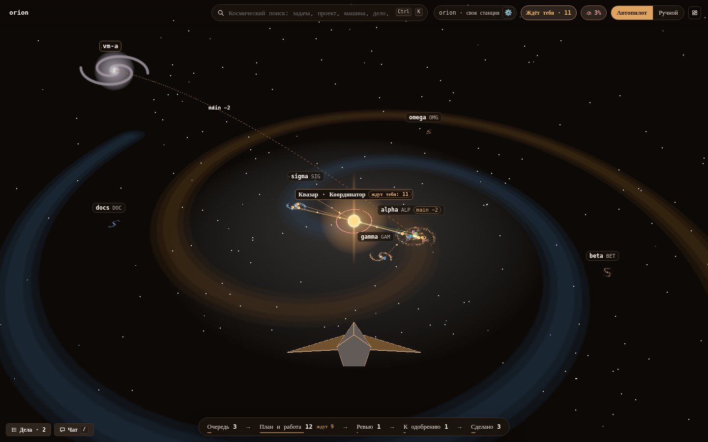
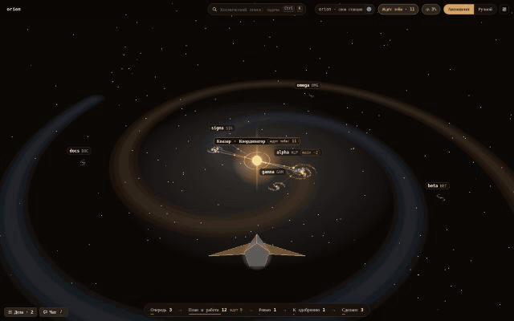
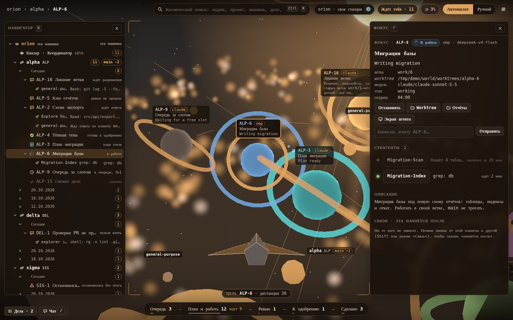
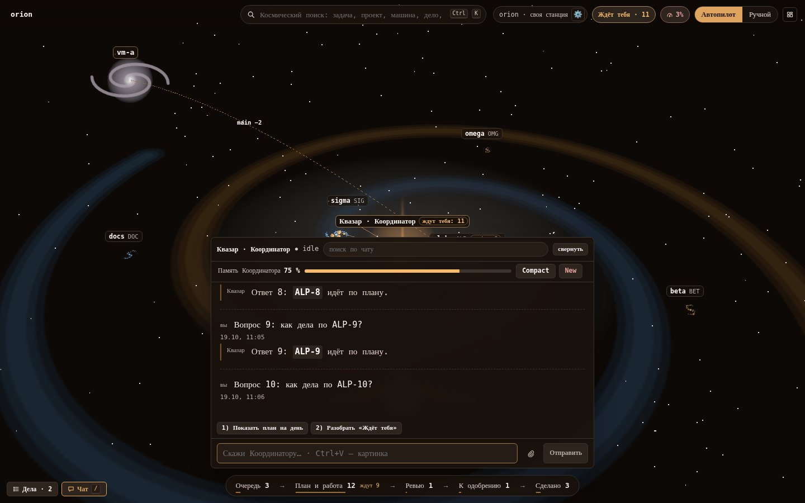
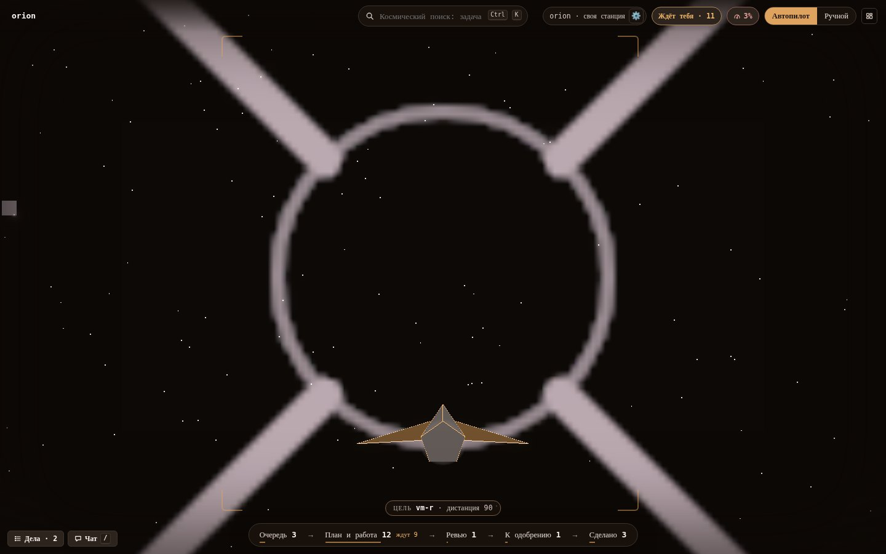
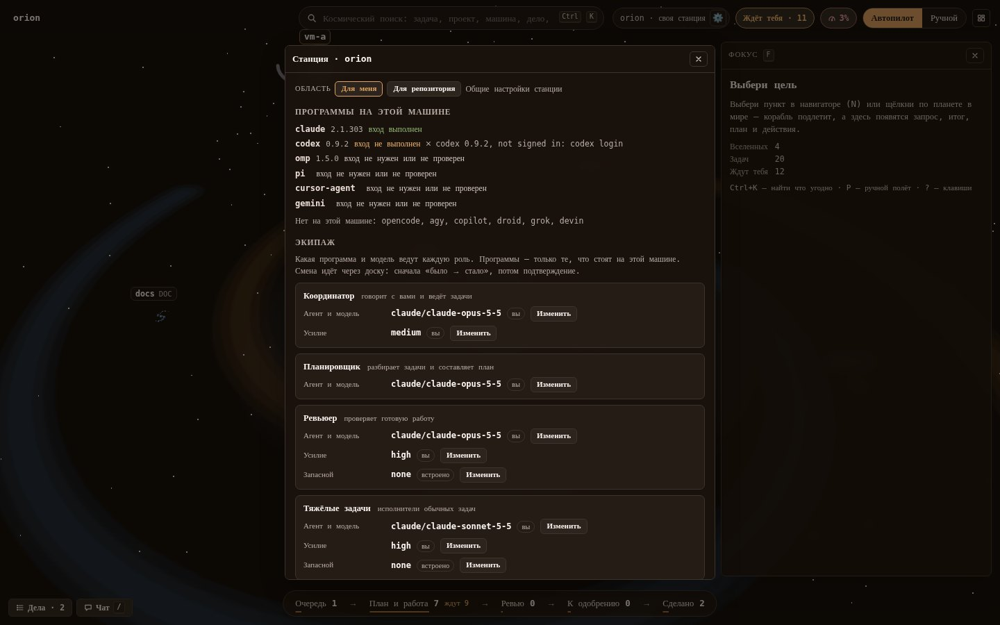
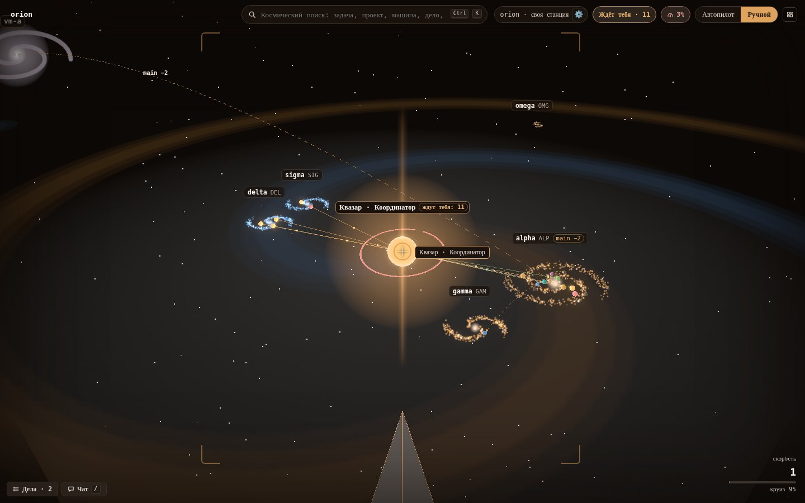
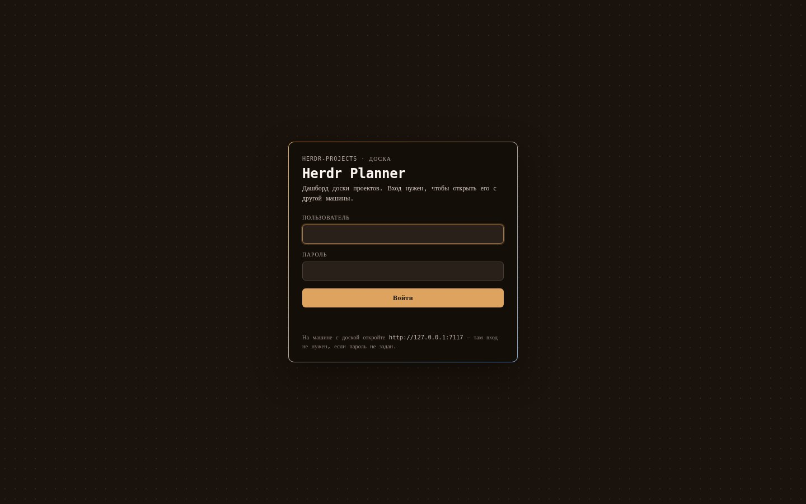

# Herdr Planner

**Your coding agents as a galaxy you fly through.** Herdr Planner is a local web dashboard for the
[herdr-projects](https://github.com/eliasstravik/herdr-projects) board (a plugin for the
[herdr](https://github.com/herdrdev/herdr) agent runtime). Your Coordinator is a quasar, projects are nebulae, tasks are
planets and sub-agents are their moons. You pilot a ship between them (or
let the autopilot do it), see what is waiting for you, answer, approve and hand out work, without leaving the
view. One Rust binary, no cloud service of its own, no telemetry. Linux and macOS; install with one `curl … | sh`
line (see «Установка»). The interface is in Russian and English; the rest of this README is in Russian.



Herdr Planner — это **Галактика** вашей доски [herdr-projects](https://github.com/eliasstravik/herdr-projects):
трёхмерный мир, по которому летает корабль оператора. Он нужен тем, кто держит много агентов сразу
(Claude, Codex, omp, pi…) на нескольких проектах и хочет видеть всю картину разом: что идёт, что
застряло, что ждёт ответа человека. Всё, что можно сделать на доске, делается отсюда: одобрить, ответить, перенести дело,
завести задачу, добавить проект. Планировщик работает с доской **этой** машины; с другими машинами работают раннеры доски и обычный `git`.



## Образ

| На доске | В Галактике |
|---|---|
| Машина с доской | **Галактика** — диск со спиральными рукавами |
| Координатор | **Квазар** в центре: неоновый шар, джеты — его речь, кольца — лимиты подписок, шкала — память (контекст) |
| Проект (git-репозиторий) | **Туманность**; папка проектов — рукав спирали, тихие проекты — дальше и тусклее |
| Задача | **Планета**; цвет и значок — статус, кольцо-ангар — основной агент (форма метки — программа) |
| Субагент | **Спутник** планеты: живой, пока работает |
| Связь `after` («начнётся после») | Линия между планетами |
| Вы | **Корабль**: виден сзади; в ручном полёте — его нос внизу кадра |

Цвет статуса дублируется значком и подписью, поэтому мир читается и без различения цветов.

## Установка

Одна строка, без root (системные пакеты — только недостающие и с вопросом):

```sh
curl -fsSL https://github.com/salehardec/herdr-planner/releases/latest/download/install.sh | sh
```

> [!NOTE]
> Архивы релизов собирает `.github/workflows/release.yml` по тегу `v*`. Пока в репозитории нет ни одного
> релиза, строка выше отвечает 404: ставьте из клона (`git clone https://github.com/salehardec/herdr-planner &&
> cd herdr-planner && scripts/install.sh --from-source`, нужны Node 22+ и Rust; страницу и бинарник скрипт соберёт сам).

**Что она ставит** (семь шагов, каждый печатает результат; повторный запуск безопасен):

| Шаг | Что делает |
|---|---|
| 1–2 | Определяет систему; доставляет недостающее из `git`, `curl`, `jq`, `ssh` (через `pacman`, `apt-get` или `brew`; `sudo` — только после вашего «да» или с `--yes`) |
| 3 | **herdr** 0.9.3 или новее — через [mise](https://mise.jdx.dev) (`github:herdrdev/herdr`); уже стоящий не через mise не трогает |
| 4 | Плагин **herdr-projects** (`herdr plugin install eliasstravik/herdr-projects`, при повторе — `update`) |
| 5 | Сам **планировщик**: готовый бинарник из релиза, контрольная сумма сверяется; `--from-source` — сборка из клона |
| 6 | **Службу** (`systemd --user`, на macOS — `launchd`), которая держит его запущенным. На Omarchy ещё: ярлык «отдельным окном», клавиша Hyprland и значок в панели |
| 7 | Вход и адрес: спрашивает, открывать ли доступ с других машин (по умолчанию нет) |

Куда что ложится: `~/.local/bin/herdr-planner` и `herdr-planner-open`, распакованный релиз — в
`~/.local/share/herdr-planner/release/<версия>/`, служба — `~/.config/systemd/user/herdr-planner.service`,
настройки — `~/.config/herdr-planner/config.toml`, данные — `~/.local/state/herdr-planner/`. Блок `PATH` для
login-shell дописывается в `~/.profile` (и `~/.zprofile`) между маркерами.

**Системы.** Linux x86_64 и aarch64 — Arch/Omarchy (`pacman`) и Debian/Ubuntu (`apt`); на другом дистрибутиве поставьте
`git curl jq ssh` сами, остальное сделает скрипт. macOS (Apple Silicon, Intel — экспериментально) собирается в CI, но
`launchd` и `brew` на настоящем Mac пока не проверялись. Windows не поддерживается.

**Команды** (после `| sh -s --` или `sh install.sh` в клоне):

```sh
curl -fsSL …/install.sh | sh -s -- --dry-run     # только показать шаги, ничего не менять
curl -fsSL …/install.sh | sh -s -- status         # что стоит, где, по какому адресу, отвечает ли служба
curl -fsSL …/install.sh | sh -s -- uninstall      # снять планировщик, службу, ярлык, значок
```

`uninstall` не трогает herdr и плагин, а также конфиг и данные (`~/.config/herdr-planner`,
`~/.local/state/herdr-planner`). Полезные флаги: `--yes`, `--version vX.Y.Z` (закрепить версию), `--no-herdr`, `--no-plugin`,
`--no-service`, `--user NAME --password-stdin --listen ADDR`, на Omarchy `--no-hypr`, `--no-shell`, `--key "SUPER + ALT + P"`.

**Обновление** — та же строка ещё раз: скрипт сравнит версии, обновит herdr, плагин и планировщик и перезапустит службу, если
что-то изменилось.

После установки откройте <http://127.0.0.1:7117> (на Omarchy — значок в панели или `herdr-planner-open`). На пустой доске
Галактика предложит добавить первые проекты из `~/Projects`.

## Что внутри кабины



- **Навигатор** (`N`): Галактика → туманность → задачи по датам создания → спутники. Без WebGL это главный вид. Название задачи — на первом месте: статус — значок и короткое слово, полный текст и полное название — во всплывающей подсказке. У задачи на ревью справа метка «ревью · pi/k3.1-pro»: кто ревьюит сейчас (своя настройка задачи, а при передаче запасному — тот, кто принял ревью), у работающей — агент и модель исполнителя; щелчок по метке выводит его терминал на передний план в herdr, а если терминала нет (ревью кончилось, агент ушёл), страница говорит об этом словами. Закончилось ревью — метки нет. Ширину тянут за правый край панели (двойной щелчок — по умолчанию, ←/→ на краю); она запоминается в браузере. Тот же край у всех боковых панелей — «Фокуса», «Ждёт тебя» и чата: ширина каждой помнится отдельно, а окно поуже ужимает её до того, что остаётся сцене — выбранные ширины боковых панелей делят остаток вместе, так что ни одна не падает до минимума, пока середина шире, чем нужно чату (своя ширина не теряется и возвращается с окном).
- **Фокус** (`F`, ширина — за левый край панели): запрос к человеку и ответы (разрешение, план, диалог на экране агента, ревью), итог агента
  (`closing.md`), описание, субагенты, связи. Задача, ждущая человека, называет причину и в бейдже, и в очереди
  («Ждёт тебя · разрешение», «план», «вопрос», «упала», «к одобрению»).
  **План ждёт одобрения**: карточка говорит «План готов — ждёт твоего одобрения», **«Открыть план»** показывает его
  целиком в окне, **«Одобрить план»** (второе нажатие — подтверждение; одобрение пишется в журнал) и
  **«Вернуть с замечаниями»** отсылают замечания из поля «Написать агенту» через `tell`.
  **Запрос разрешения**: когда агент стоит на диалоге, карточка показывает с его экрана, что именно просится
  (инструмент, файл или команда), и кнопки строк диалога — **«Разрешить»**, **«Разрешить и не спрашивать в этой
  сессии»**, **«Запретить»**; каждая посылает нужную клавишу в панель агента, а **«Экран агента»** открывает сам экран.
  Доска не всегда называет диалог: агент, остановившийся на нём, приходит видом «вопрос» или вовсе без вида, а его
  сообщение — «Needs you»; экран и есть свидетель, поэтому карточка разрешения строится по нему, в том числе для
  файловых запросов Claude Code («…switch to accept edits … for this session» — это «Разрешить и не спрашивать»).
  **Вопрос агента** показывает свои слова из доски или с экрана, а когда текста нет — так и говорит («Агент ждёт тебя,
  текста вопроса нет») и предлагает экран; «Needs you» — это слова доски, а не вопрос, и на карточке их нет. Если план ждёт одобрения, а агент заодно стоит на диалоге, одобрение плана
  идёт первым, диалог — второй строкой. Текст не на языке интерфейса можно перевести кнопкой. Кнопки
  **«Развернуть»** у итога и у описания (а «Открыть план» — у плана) открывают центрированное окно поверх Галактики (с полями от краёв): широкая
  колонка с разметкой Markdown и прокруткой, текст запроса и те же действия задачи, что в Фокусе («Одобрить», «Всё равно
  влить», вернуть агенту с текстом, «Перевести на русский»); `Esc`, **«Свернуть»** или щелчок по фону закрывают окно.
- **Экран агента** — кнопка в «Фокусе» (у запроса ревью — «Показать экран ревьюера») открывает центрированное окно поверх
  Галактики с затемнением: терминал агента крупным моноширинным шрифтом, с прокруткой и цветами (ANSI, если herdr их отдаёт);
  длинный экран сохраняет свой конец — свежий вывод, поле ввода и диалог внизу (начало помечено «…»), а не только первые
  строки; видно время последнего обновления, экран обновляется сам примерно раз в полторы секунды — и замирает, когда вкладка
  скрыта или агент остановлен (в том числе агент, который уже вышел), а с закрытием окна опрос прекращается.
  Внизу — «Написать агенту»: `Enter` отправляет те же слова, что «Отправить» в «Фокусе» (`tell`), `Shift+Enter` —
  новая строка; окно остаётся открытым и читает экран заново. `«/»` в этом поле открывает команды программы агента
  **этой задачи**, `«@»` — задачи, вселенные, верфи, файлы репозиториев и картинки чата (см. «Подсказки ввода» при
  описании чата). Клавиши диалога
  (стрелки, `Enter`, `Esc`, `1`…`3`, `Y`, `N`) уходят через `herdr agent send-keys`. `Esc`, **«Свернуть»** и щелчок по фону
  закрывают окно.
- **Меню выбора агента — кнопками.** Когда программа агента ждёт выбор в своём меню — вопрос `AskUserQuestion` в Claude Code
  (варианты с описаниями, «Type something», несколько вопросов, множественный выбор с флажками и «Submit»), одобрение команды
  в Codex и Claude Code, `ask` в omp — планировщик узнаёт его по экрану панели (`herdr agent read`, разбор — `src/menu.rs`) и
  показывает **карточкой с кнопками**: над строкой ввода в чате Координатора (свёрнутом и развёрнутом) и над терминалом в
  окне «Экран агента» задачи. Кнопка варианта — это его выбор: сервер заново читает экран и посылает стрелки от того места,
  где сейчас курсор, и `Enter` (множественный выбор — пробелами по флажкам и «Отправить»; несколько вопросов приходят по
  одному, по мере того как программа показывает следующий). **«Свой ответ»** открывает поле: слова уходят в строку
  «Type something» (в omp — в её редактор «Other»), `Enter` — отправить, `Shift+Enter` — новая строка. **«Отменить»** — `Esc`
  программы. Длинные описания свёрнуты до двух строк («Ещё»), подробности вокруг вопроса (команда на одобрение, ответы
  до сих пор) — по кнопке «Подробнее», а «Экран» показывает то, что видно в терминале. После ответа карточка показывает
  выбранное и не нажимается; если то же меню всё ещё на экране через восемь секунд, ответ не дошёл — можно ответить снова;
  ответ в самом терминале закрывает карточку. Ответ на меню, которое уже сменилось, сервер отклоняет (409) и ничего не
  нажимает. Экран, который не удалось разобрать, показывается как раньше: текст, клавиши и строка ответа.
- **Ждёт тебя** (`B`, ширина — за правый край; шире навигатора — и чат с делами начинаются после неё): очередь запросов; каждая строка называет причину («план», «разрешение», «вопрос», «упала»,
  «к одобрению»), а готовый план — «План готов — ждёт твоего одобрения»; ответили — запрос вычеркнут, курсор на следующем.
  Кнопка в верхней панели мягко пульсирует, пока в очереди что-то есть, и затихает при нуле (при `prefers-reduced-motion` —
  без анимации, только цвет). Действия человека по задачам (одобрил план или слияние, вернул с замечаниями, разрешил или
  запретил действие агента, ответил агенту) доходят до Координатора одной строкой «[Действие в планировщике] PLN-60: план
  одобрен» — тем же путём, каким доска шлёт ему уведомления, — и видны в чате как уведомление, а не как реплика человека.
- **Чат с Координатором** (`/`): история, поиск по чату, вложения (текст, картинки, звук: скрепка, перетаскивание, `Ctrl/Cmd+V`), шкала памяти, многострочная строка ввода до 100 000 символов и не длиннее 130 000 байт UTF-8 — это около 65 000 русских букв (`Enter` — отправить, `Shift+Enter` — новая строка; дольше — понятный отказ, не обрезка); кнопки «Сжать» и «Новый»
  (в английском интерфейсе *Compact* и *New*). Кнопка **«Развернуть»** раскладывает окно колонками: навигатор | чат на всю
  высоту | «Фокус» (мир за ними приглушён); кнопка «Дела» в шапке развёрнутого чата открывает дела колонкой между навигатором
  и чатом (если места не хватает на колонку дел и чат от 30 rem, «Фокус» уходит в сторону, пока дела открыты); `Esc` — на шаг
  назад (дела → обычный чат → «Скрыть»). Развёрнутость и дела запоминаются в браузере. Развёрнутый чат стоит **по центру**
  свободного места между навигатором и «Фокусом» (закрытая панель отдаёт свою сторону краю окна; при открытых делах — по центру
  места правее их колонки). Свёрнутый чат — до 54 rem (864 px при 100 %, на окнах шире 1400 в единицах интерфейса — и не больше
  40 % ширины окна, то есть 768 px на 1920 и 864 px на 2560 при 100 %); ширина тянется за левый край чата (двойной щелчок —
  по умолчанию; окно поуже ужимает её до места между панелями) и помнится в браузере; колонка текста реплик — не шире 80 знаков.
  **Непрочитанное:** новый ответ Квазара (и уведомление доски с ответом) помечен **зелёным огоньком** у метки «Квазар». Он гаснет
  (мягко; при `prefers-reduced-motion` сразу), когда сообщение побыло в видимой части **открытого** чата, пока окно планировщика
  активно. Пока чат скрыт или окно не в фокусе, огонёк остаётся, а на кнопке «Чат» и в шапке чата — зелёное число непрочитанных;
  кнопка в шапке («↓ N новых») и открытие чата ведут к первому непрочитанному. «Прочитано» помнится в браузере по сообщениям
  (переживает перезагрузку); помнится, *какие слова* прочитаны, поэтому ответ, пришедший в ту же реплику после промежуточной строки («Сейчас посмотрю…»), снова загорается; уведомление доски без слов Квазара тоже считается; чат, открытый после перезагрузки, тоже идёт к первому непрочитанному; при первом запуске всё, что уже есть в чате, считается прочитанным.
- **Подсказки ввода** в строке чата и в поле «Написать агенту» задачи. Сообщение доходит до программы Координатора слово в
  слово, поэтому `«/»` **в начале сообщения** открывает список её собственных команд: у Claude Code — встроенные (`/compact`,
  `/clear`, `/model`…), навыки из `~/.claude/skills`, навыки и команды установленных плагинов (под именем плагина —
  `/superpowers:brainstorm`), ваши команды из `~/.claude/commands` и из `.claude` папки Координатора — с описанием из их
  файлов; у Codex — его команды и `~/.codex/prompts`; у omp и pi — их собственные команды (`/compact`, `/model`, `/new`,
  `/resume`, `/settings`…) и навыки из их папок, названные так, как их зовёт сама программа — `/skill:<имя>`; у
  opencode/gemini и прочих, чьих команд узнать нельзя, подсказок нет, и поле работает как раньше. Список
  **фильтруется по мере ввода** (и с опечаткой, и не в той раскладке), стрелки/Tab ходят по
  нему, `Enter` вставляет команду, `Esc` закрывает; список кэшируется и перечитывается при смене программы Координатора
  («Экипаж») — в поле задачи это программа её агента. `«@»` ищет сразу по задачам доски (вставляет id, например `PLN-25`),
  вселенным (папка репозитория), этой Галактике, верфям, **файлам и папкам репозиториев** (вставляет полный путь — Координатор
  работает не в папке репозитория) и картинкам чата (путь файла на машине с доской); группы с заголовками. Пока список
  открыт, `Enter` выбирает пункт, а не отправляет сообщение; `Esc` закрывает только список, `Shift+Enter` — по-прежнему
  новая строка.
- **Дела** (`T`) — выпадающая панель **сверху** (quake): выезжает из-под строки поиска полосой по центру, `T` и `Esc`
  (на шаг назад) убирают её. Чат — внизу: оба открыты разом и не перекрывают друг друга, навигатор и «Фокус». Поле ввода
  дела — многострочное: текст переносится по ширине, поле растёт до нескольких строк и дальше прокручивается, `Enter`
  добавляет дело, `Shift+Enter` — новая строка (переносы сохраняются). Поле принимает до 100 000 символов и не длиннее
  130 000 байт UTF-8 (около 65 000 русских букв: текст уходит на доску одним аргументом, а Linux не даёт ему быть длиннее
  128 КиБ); более длинный текст не обрезается, а отклоняется с сообщением. В списке длинное дело свёрнуто до трёх строк с кнопкой «Ещё». К делу
  можно прикрепить файлы — текст, картинки, звук: «Обзор…», перетаскивание на панель, вставка скриншота (`Ctrl/Cmd+V`); до
  сохранения у каждого есть превью. Файлы лежат на сервере (за входом; картинка до 10 МБ, звук до 25 МБ, текст до 2 МБ; вид
  определяется по байтам, HTML и SVG — просто текст) и едут вместе с делом путями на машине с доской, когда оно становится
  сообщением или задачей. Карточку можно перетащить: **в чат** — черновик сообщения Координатору со вложениями (дело остаётся
  в списке с пометкой и уходит из него, когда сообщение отправлено); на
  **планету** — окно правки, затем `tell` её агенту; на **Квазар** — Координатору; на **туманность** — окно новой задачи
  (слова, файлы, проект, программа, модель; файлы идут в описание).
- **Подписи кнопок** — с заглавной буквы в обоих языках (значения вроде имени машины или программы — не подпись);
  страница проверяет это на живой странице.
- **Канбан-строка** внизу: «Очередь · План и работа · Ревью · К одобрению · Сделано», счётчики и фильтр мира.
- **Память**: у Квазара — Галактики, у туманности — вселенной (Markdown-файлы, см. [«Память Галактики»](#память-галактики)); «В память» у сообщений чата и итогов.
- **Поиск** (`Ctrl+K`, по центру сверху, ничем не перекрывается): задачи, проекты, дела, сообщения чата, записи памяти и итоги задач; нечёткий — с опечатками, `е`/`ё` и не той раскладкой.
- **Лимиты подписок** (`Q`), **журнал** (`J`), **архив** (`R`).
- **Верхняя строка**: слева меню (иконка-сетка), хлебные крошки, затем мониторинг — шкалы загрузки и сразу справа от них короткий чип подписок («49 % Claude Code» — остаток самого близкого к исчерпанию лимита и программа; на узком окне он сворачивается до процента, подробности — в карточке); поиск; справа только «Ждёт тебя» и «Автопилот / Ручной».
- **Загрузка машины** в верхней строке, справа от хлебных крошек: шкалы CPU, MEM и (если есть видеокарта) GPU с процентами. Цвет по порогам: до 70 % — норма (зелёный), с 70 % — высокая (жёлтый), с 90 % — критическая (красный); это цвета темы для состояний, не акцент, а процент всегда написан, и на шкалах есть засечки 70 и 90 %. Наведите курсор (или перейдите табом, или коснитесь на сенсорном экране) — под шкалами раскроется карточка с точными значениями: ядра, ГБ занято/всего, по каждой видеокарте загрузка и видеопамять, диск (если машина его сообщает), время последнего чтения и ссылка «Подробнее» (перелёт к Галактике). Тот же способ у чипа подписок: карточка показывает все лимиты всех подписок (Session, Weekly, по моделям) с остатком, временем сброса и «через N ч», цветом по порогам, и ссылку «Лимиты подписок». Карточка выровнена по своему элементу и не выходит за окно, не мерцает при переходе курсора на неё (небольшая задержка закрытия) и закрывается по Esc, уходу курсора, клику или фокусу в другом месте. Хлебные крошки главнее: шкалы берут то, что осталось (с названием машины → три шкалы → маленькие шкалы под цифрами → одна, худшая → ничего). Цифры читаются раз в 3 с и только пока открыта страница: `/proc/stat` и `/proc/meminfo`, видеокарты NVIDIA — `nvidia-smi`, AMD — `/sys/class/drm`; на машине, где прочесть нельзя, шкалы серые с «нет связи с …». Планировщик показывает только эту машину.



### Верфи

**Верфь** — машина с Docker без доски: агенты этой доски выносят туда контейнеры, стенды и сборки
(`DOCKER_HOST=ssh://…`), а планировщик читает её состояние по SSH и убирает забытое. Верфь живёт сразу за границей
Галактики — кольцо с перекладинами. В навигаторе — группа **«Верфи»**, в поиске — вид «верфь».

- **Фокус верфи**: загрузка CPU, память, диск docker и GPU (если есть); контейнеры задач с живучестью, CPU, памятью и
  портами; **забытые** (задача завершена, контейнер жив), неясные и свёрнутый список чужих. Кнопки «Обновить»,
  «Терминал», «Посчитать место» (карточка уборки диска), блок «Автоуборка».
- **Уборка** — карточка «было → стало»: галочки, счётчики контейнеров/сетей/томов и освобождаемые мегабайты, два нажатия.
  Удаляются только точные id из показанного плана; контейнеры задач в работе, чужие и защищённые маски не проходят даже
  при явном запросе. Неясные (тег есть, задачи на доске нет) стоят в карточке серым и без галочки по умолчанию:
  их убирает только человек, поставив галочку. Сама по себе уборка забытого ничего не удаляет: это делает только
  включённая автоуборка (ниже).
- **Уборка диска** — кнопка «Посчитать место» на верфи: один read-only вызов по ssh (`docker system df -v`,
  `docker buildx ls`), без удаления. Карточка «было → стало» показывает по видам: образы без контейнеров, кэш сборки,
  остановленные контейнеры (только забытые контейнеры завершённых задач), сборщики buildx (и остатки их данных),
  неиспользуемые тома. У видов и у каждой строки своя галочка, видно, сколько диска освободится. Тома, а также сборщики и их остатки под маской защиты, по умолчанию без
  галочки и с предупреждением (том может хранить чужие данные); тома под маской защиты и тома задач в работе в список не
  попадают. Запущенный сборщик и чужие контейнеры не предлагаются. Запускается только отмеченное, после второго нажатия:
  `docker rm -v` по id, `docker buildx rm`, `docker volume rm` по именам, `docker image prune -a -f`,
  `docker builder prune -a -f` (без `docker volume prune` и `docker system prune`). Перед запуском сервер считает заново и
  сверяет каждую галочку со свежим подсчётом; запись о результате — в журнале.
- **Логи и управление контейнером** — у каждого контейнера задачи в Фокусе верфи (и в Фокусе самой задачи) кнопки
  «Логи», «Остановить», «Перезапустить», «Удалить». «Логи» — окно с хвостом (`docker logs --tail 100/300/1000`),
  которое обновляется само, пока открыто (опрос останавливается при закрытии, при скрытой вкладке и у остановленного
  контейнера), с поиском по строкам. В журнале контейнера задачи — вывод команд `scripts/yard.sh` (build, test, web,
  section, pages, check, quick, run): `yard.sh` дублирует его в stdout главного процесса (`/proc/1/fd/1`), поэтому он
  виден и в `docker logs`; перед выводом — строка `[yard] ▶ время · yard.sh команда · run …`, после — `[yard] ■ …
  · exit N · длительность` (в окне — зелёным при `exit 0`, красным иначе). Агент получает вывод как раньше, код возврата
  тот же. Размер журнала ограничен самим docker: `json-file`, 3 файла по 8 МБ (`YARD_LOG_MAX`, `YARD_LOG_FILES`); старый
  контейнер без границы пересоздаётся при первом запуске, когда на нём ничего не идёт. Остановка, перезапуск и удаление — карточка «было → стало» и два нажатия;
  в команде только полный id (`docker stop|restart <id>`, `docker rm -v <id>` без `-f`: запущенный сначала
  останавливают). Запрет (кнопка серая с причиной, сервер проверяет заново): чужие контейнеры (без метки `herdr.task` и без тега задачи
  в имени или проекте compose, или под маской) — всё, включая логи; неясные — остановка/перезапуск/удаление; контейнер задачи в работе — только из Фокуса
  этой же задачи, из экрана верфи и из другой задачи нельзя. Каждое действие — строка в журнале.
- **Порты и Shell контейнера** — в таблице «Контейнеры задач» и в Фокусе самой задачи у опубликованного порта видна
  дорога к нему. HTTP-порт (80, 443, 3000, 5173, 8080, 8000, 9000 и ещё несколько обычных; 443 и 8443 — `https`)
  становится ссылкой на адрес, к которому docker привязал порт (для привязки на все интерфейсы — адрес для портов
  верфи), известный образ — строкой подключения (`postgres` →
  `psql -h … -p … -U postgres`, `redis` → `redis-cli -h … -p …`), остальное показывается отображением
  `порт на верфи → порт в контейнере/протокол`. Порт, привязанный на верфи к `127.0.0.1`, ссылкой не становится: с
  этой машины он не виден, и подсказка говорит почему. «Shell» у контейнера задачи (кроме чужих, неясных, общих
  кэшей сборок и неработающих контейнеров) открывает терминал этой машины: он по ssh входит на верфь и запускает
  `docker exec -it <id> sh -c '…exec bash… else exec sh'` — bash, если он есть в образе, иначе sh. Как и «Терминал»,
  Shell открывается только за компьютером с доской.
- **Терминал, понятный любой машине** — перед оболочкой оба терминала («Терминал» верфи и «Shell» в контейнере)
  спрашивают у той стороны её собственный terminfo для `TERM` (`infocmp`, иначе `tput longname`, иначе сам каталог
  базы): тип, которого там нет (`xterm-kitty` у kitty, `foot-extra`…), заменяется на `xterm-256color`, а тот, если
  нет и его, — на `xterm`. `dumb`, `unknown` и пустой `TERM` — тоже замена: полноэкранной программе на них не
  нарисовать. `COLORTERM` (`truecolor`) сохраняется — он едет от терминала отдельным словом, потому что ssh передаёт
  только `TERM`. Так `htop`, `top`, `less` и `vim` открываются и перерисовываются при изменении размера окна и на
  верфи, и в контейнере задачи; файлы на верфи не меняются — проверка только читает.
- **Автоуборка** — блок в Фокусе верфи (по умолчанию выключена; включение — осознанное, с двумя нажатиями): контейнеры,
  сети и тома завершённых и архивных задач (по метке `herdr.task`; имя без метки для автоуборки не считается) удаляются
  сами через заданное время после завершения задачи (по умолчанию 6 ч). Работает в цикле опроса верфей; чужие,
  неясные и маскированные не трогаются, не прошедшее время — тоже. Каждая уборка пишется в журнал верфи, счётчик
  «Убрано автоматически» виден в Фокусе всегда. Задача считается завершённой, если она сделана или архивная и агент
  ушёл: есть `exitedAt`, или доска видела закрытую панель (`last.gone`), или задача в архиве; время отсчитывается
  от этого момента. Перед включением и перед сокращением времени первое нажатие показывает, что уберётся сразу.
- **Журнал верфи** — блок в Фокусе верфи: кто и что делал на машине и когда. Строки — остановка, перезапуск и
  удаление контейнера, ручная уборка и уборка диска, автоуборка (включение, выключение и каждый проход, который
  что-то убрал или не смог), подключение и отключение блока правил агентам, удаление верфи из списка, а также
  периоды, когда верфь не отвечала (одна строка на период: начало, конец и причина). В строке действия — задача и
  имя контейнера, в ручной и дисковой уборке — сколько контейнеров, сетей и томов ушло и сколько освободилось, у
  автоуборки — задачи. Видно, кто действовал: человек, автоуборка или планировщик. Есть фильтр по виду и поиск по
  имени контейнера, задаче и причине (ищет по всему сроку хранения, не только по первой странице). Журнал лежит в
  базе планировщика (`runner_log`) и хранится 90 дней; открытый период недоступности не забывается, пока верфь
  молчит. Убранная из списка верфь оставляет журнал: он снова виден, если верфь добавить с той же меткой.
- **Тревоги верфи** — строка в «Ждёт тебя» и блок в Фокусе верфи: мало свободного места на диске docker (порог у
  верфи, по умолчанию меньше 10 %), верфь не отвечает дольше заданного времени (по умолчанию 10 мин), появился забытый
  контейнер, контейнер задачи упал или перезапускается. Пороги задаются в карточке «Настройки верфи…» этой верфи:
  `0 %` выключает тревогу о диске, а `0 мин` — тревога о молчании срабатывает сразу. Координатору уходит одно
  сообщение о каждой тревоге: пока состояние то же, повтора нет. Прошедшей тревога считается, только когда её нет в
  полных чтениях верфи дольше десяти минут: контейнер, пойманный «Up» между перезапусками, и диск, качнувшийся у
  порога, повтора не дают. Тревога, вернувшаяся после такого перерыва, — новое сообщение. Пока верфь не отвечает,
  о её контейнерах и диске тревог нет: последнее чтение устарело, и тревога о молчании говорит всё.
- **Лимиты задач на верфи** — у каждой верфи свои `--cpus` и `--memory` на контейнер задачи и, если нужно, максимум
  контейнеров на задачу; задаются в карточке «Настройки верфи…» рядом с метками. Пока человек их не задал, верфь берёт
  долю машины с первого удачного чтения: четверть процессоров (1 … 8) и восьмую часть памяти (512 МиБ … 8 ГиБ,
  округлённо до половины гибибайта), максимум контейнеров — без ограничения. Значения уходят в блок правил агентам
  примерами `docker run` и compose (`deploy.resources.limits`), а контейнер живой задачи, у которого нет этих лимитов,
  помечается в Фокусе верфи («без лимитов»); задача, держащая контейнеров больше максимума, называется там же.
  `0` в поле — сознательное «без ограничения».
- **Несколько верфей: выбор верфи задачи** — у задачи или её репозитория может быть правило: верфь по метке, нужные
  метки (`gpu`, `x86_64`, …) или и то и другое. Правило задачи заменяет правило репозитория; без правила — верфь по
  умолчанию. Подходящие верфи перебираются по порядку (названная, по умолчанию, остальные); верфь, которая не отвечает
  или загружена выше порога (`load1` не ниже своего процента числа ядер; 0 — не проверять), уступает следующей, а если
  заняты все — берётся наименее загруженная. Карточка «Выбрать верфь…» в Фокусе задачи правит правило задачи и
  репозитория; там же видно, какая верфь выбрана, почему и какие запасные. Правило уходит в `runners.json`
  (`assign`, `need`, `tasks`, `busy_pct`), а подключённым агентам — отдельным блоком в инструкции репозитория или
  задачи с точной верфью и запасными. `scripts/yard.sh` выбирает верфь по тем же правилам (и `where` показывает её).
- **История и расход** — Фокус верфи держит загрузку CPU, памяти и диска docker за последние часы и сутки:
  спарклайны с переключателем «3 ч / сутки» и числом «сейчас · пик». Точки хранятся в базе планировщика прореженными:
  по минуте за 6 часов, потом по 10 минут за сутки, дальше забываются. Там же — расход по задачам: время CPU и пик
  памяти контейнеров каждой задачи по метке `herdr.task` (память — сумма живых контейнеров задачи в один замер, пик —
  наибольшая); те же числа вида «ЦП 2,5 ч · пик 1,2 ГиБ» стоят в Фокусе задачи с разбивкой по верфям. Время CPU
  считается трапецией между двумя чтениями верфи (`docker stats` даёт мгновенный процент); пауза дольше 15 минут не
  считается — что было на молчавшей машине, неизвестно. Убранная из списка верфь уносит свою историю.
- **Добавить верфь…** (навигатор): три шага — проверка машины (ОС, ядра, Docker, compose, GPU) и входа с этой машины
  так, как ходят агенты (`ssh`, клиент `docker`, `docker` через ssh), метки и маски защиты, затем запись списка и
  предложение подключить агентов. Ключи не хранятся: только `ssh-agent` и `~/.ssh/config`.
- **Источник правды** — `~/.herdr-projects/settings/runners.json` на этой машине (права `600`): верфи, их метки, порог
  занятости, а также правила `assign` (верфь репозитория), `need` (метки репозитория) и `tasks` (верфь или метки
  задачи). Планировщик держит блок правил про Docker в `worker.instructions` и `reviewer.instructions` этой машины —
  карточка «Верфи для агентов» на Станции: она показывает точный текст, который будет записан, и убирает старые строки
  про `DOCKER_HOST` только по отдельной галочке (правила человека рядом остаются); у правила репозитория или задачи —
  свой блок в его собственных инструкциях, чтобы агент знал верфь задачи и запасные. Общий блок короткий (≈1,2 КБ вместо 2,4 КБ: без примера compose и без порога занятости — выбор занятой верфи делает `yard.sh`, а не агент); размер держит тест. Чужие контейнеры (маски соседних сервисов, например `buildx_*`) не трогаются никогда; маски проверяются и
  по имени контейнера, и по имени compose-проекта.



### Станция и бортовой компьютер

**Станция** (пункт «Станция» в меню слева в верхней строке): какие программы агентов стоят на машине и вошли ли
они, какая программа и модель ведут каждую роль (Координатор, Планировщик, Ревьюер, исполнители) и все настройки доски со
значением и источником. Правка идёт через `herdr-projects set`/`unset`, сначала карточкой «было → стало» и списком задач,
которых это касается, потом подтверждением.

**Экипаж: подписки, модели и наборы.** Наверху Станции одна строка: кто ведёт каждую роль и какие подписки недоступны.
Карточка каждой программы говорит, выполнен ли вход и под каким тарифом (`Max 5x`, `ChatGPT sign-in (go plan)`), не
исчерпан ли лимит и когда он сбросится (окна лимитов — из записей Omarchy; «out of allowance until …» — из строки задачи
на доске), какие роли и задачи её сейчас используют, а у omp, pi и opencode — какие провайдеры внутри. Чего узнать
нельзя, там написано «неизвестно» и почему. Модели берутся из `herdr-projects models <программа>` и выбираются из списка,
а не вводятся; у программы без списка (omp, kimi) предлагаются модели, с которыми её использовали, и её модель по
умолчанию. Запасных (`worker.fallback`, `reviewer.fallback`) собирают цепочкой из установленных подписок: добавить,
поднять, убрать.

**Наборы экипажа** задают всем ролям агента, модель, усилие и запасных. Их можно сохранить из текущего экипажа, создать
из шаблона («Экономный», «Максимум», «Только Claude», «Без Claude» — по моделям, что есть на машине), изменить,
переименовать, удалить. Применение: полный список «было → стало» по всем ролям с командой доски у каждого шага,
предупреждение об идущих и ждущих задачах, потом два нажатия — и доска получает свои `set`/`unset` по очереди, в порядке
списка (роли: Координатор, Планировщик, Ревьюер, Тяжёлые задачи; у каждой агент, усилие, запасной). Остановка на отказе
доски описывает, что успело выполниться. Пустое поле набора снимает запись доски (возвращается значение ниже по уровню).
Наборы лежат у планировщика, в `~/.local/state/herdr-planner/crew-presets.json`; доска их не видит.



**Зависшие процессы завершённых задач** (в той же «Станции», под «Верфями для агентов»). После задачи агент (`omp --resume=…`)
или его помощник (`node …/rea.mjs mcp`, `omp __omp_worker_daemon_broker`) иногда остаётся работать в рабочей копии, и доска
пишет «Kept: … its space is in use beside its agent», не удаляя её. Планировщик раз в минуту (и по кнопке «Проверить»)
смотрит таблицу процессов **своего пользователя** и находит те, чья текущая папка внутри рабочей копии задачи, которая
завершена или в архиве (или копии `work-<n>`, которой у задачи уже нет): по папке и состоянию задачи, не по имени программы. Показывает
задачу, pid, команду, сколько работает и сколько памяти. Пока доска не читается или её данные старше 5 минут, процессы не оцениваются вовсе; копия без задачи считается брошенной, только если её номер меньше самого нового известного номера в репозитории (задачу, начатую после чтения доски, не принять за брошенную). Задачи в работе, процессы вне рабочих копий доски, чужие процессы и сам
планировщик с его родителями никогда не показываются и не трогаются. «Остановить» — «было → стало» и второе нажатие; каждый процесс
перед сигналом ищется заново (тот же pid и время старта, всё ещё от завершённой задачи); сначала SIGTERM (агент раньше своих
помощников, чтобы живой агент не перезапустил их), через несколько секунд SIGKILL тем, кто остался. **Автоуборка** выключена по умолчанию;
включённая, она останавливает процессы, которые видны дольше 5 минут, но не оболочки терминала; каждая остановка пишется в журнал карточки
и в журнал планировщика. Рабочую копию дальше убирает доска, планировщик её не удаляет.

**Бортовой компьютер** (меню) — настройки самого планировщика: язык, мышь, упрощённый
режим, уведомления, папка для новых вселенных, логин и пароль, адрес прослушивания.

### Проекты

«Добавить вселенную»: папка с git или адрес репозитория (GitHub через `gh`, GitLab.com и свой GitLab через `glab`).
**Своё** — клон; **чужое, хочу менять** — форк (`origin` — ваш, `upstream` — оригинал, есть «подтянуть» и «PR/MR в оригинал»);
**чужое, изучать** — клон без записи. Отставший клон помечен «main −N», а «Предложить обновить» заводит на доске задачу «подтянуть главную ветку»
(сам планировщик в чекаутах ничего не меняет).

## Управление

**Автопилот** (по умолчанию): выберите цель в навигаторе (`N`) или найдите поиском (`Ctrl+K`), и корабль сам прилетит
(разгон → варп → торможение). Мышь вращает обзор вокруг цели, колесо — ближе/дальше, клик по вещи — перелёт к ней.

**Ручной полёт** (`P`): как в игре. `W A S D` или стрелки — вперёд/назад/вбок, `Space` / `C` — вверх/вниз, `Shift` — форсаж,
колесо — круизная скорость, мышь — курс (клик по пустому месту захватывает мышь, `Esc` отпускает). Наведите прицел на
туманность, планету, спутник или Квазар и кликните (или удержите) — корабль нырнёт в неё. Границу
Галактики не пересечь: корабль мягко разворачивается. Клавиши читаются по физической клавише, раскладка не важна.



**`Esc` — ровно один шаг назад**, как «назад» в браузере: закрыть панель → выйти из «Фокуса» → из туманности. Действие
(одобрить, ответить, связать) оставляет вас на месте; а то, куда вы сами перелетели, кладётся в стек, и `Esc` вернёт обратно
с камерой, панелями и выделением.

| Клавиши | Что делают |
|---|---|
| `Ctrl+K` | космический поиск (по центру сверху) |
| `Ctrl+=` / `Ctrl+−` / `Ctrl+0` | масштаб интерфейса: крупнее / мельче / авто (масштаб страницы браузера не трогают) |
| `P` | автопилот ⇄ ручной полёт |
| `N` / `F` / `T` / `J` / `R` | навигатор / фокус / дела (панель сверху) / журнал / архив |
| `B` | «Ждёт тебя»: очередь запросов; `1–9` — N-й запрос |
| `/` | чат с Координатором |
| `H` | домой (своя Галактика) · `0` / `Home` — общий вид |
| `Enter` | подлететь к выбранному |
| `Tab` / `Shift+Tab` | следующая / предыдущая планета по срочности |
| `[` / `]` | предыдущая / следующая туманность |
| `L` или `Shift` + тяни | связь `after` между задачами |
| `Q` | лимиты подписок |
| `?` | подсказка · `Esc` — шаг назад |

**Упрощённый режим** включается сам при слабом железе, по `prefers-reduced-motion`, через `?calm` или в бортовом компьютере: без
bloom и движения частиц, перелёты мгновенные. Без WebGL остаются навигатор, поиск и все действия.

**Размер интерфейса.** Все размеры — в `rem`, корневой шрифт растёт с окном (16 px до 1600×1000, дальше пропорционально
экрану: 2K ≈ 23 px, 4K ≈ 35 px), подписи мира и HUD тоже. «Масштаб интерфейса» в бортовом компьютере (авто или 80–250 %)
и `Ctrl+=` / `Ctrl+−` / `Ctrl+0` заменяют авто на фиксированный процент от 16 px; выбор помнится в браузере.
Окна, при которых раскладка меняется (до 1100, 1000, 900 px…), считаются в тех же единицах: чем крупнее интерфейс, тем «уже» для него окно,
и на 150 % окно 1366 px получает ту же раскладку, что окно 911 px при авто.

## Вход и удалённый доступ

По умолчанию служба слушает только `127.0.0.1:7117`, вход не нужен. Адрес, не являющийся loopback, без пароля планировщик
не запустит. Открыть доступ можно тремя способами.

**Логин и пароль** (чтобы слушать другие адреса). Установщик спросит их сам или:

```sh
curl -fsSL …/install.sh | sh -s -- password --user me --listen 0.0.0.0    # пароль — вопросом в терминале
printf '%s' "$PW" | sh install.sh password --user me --password-stdin       # из клона, без вопроса
```

Пароль хранится как хеш Argon2id в `config.toml` (права `600`), сессия — cookie `HttpOnly; Secure; SameSite=Strict`, после
5 неудачных попыток за 5 минут адрес блокируется, а весь API и поток событий закрыты входом. Логин и пароль можно сменить
и в бортовом компьютере, но только с самой машины планировщика.



**HTTPS.** Cookie сессии `Secure`, поэтому по обычному `http://` с другой машины браузер её не сохранит. Свой сертификат:
`sh install.sh tls --cert fullchain.pem --key privkey.pem` (пишет `tls_cert`/`tls_key` в конфиг и перезапускает службу).

**SSH-туннель** — проще всего и без паролей и сертификатов: на своём компьютере

```sh
ssh -N -L 7117:127.0.0.1:7117 user@хост    # затем http://localhost:7117
```

Для браузера `localhost` — защищённый контекст, так что `Secure`-cookie работает и без TLS. Службе достаточно слушать `127.0.0.1`.

**Свой обратный прокси** (nginx, Tailscale Serve) на этой же машине: запрос с адреса `127.0.0.1` принимается, только если его
`Host` — `localhost`, `127.0.0.1`, `[::1]` или имя из списка `trusted_hosts` в `config.toml`; иначе ответ `421` (так страница
чужого сайта, чьё имя указывает на `127.0.0.1`, не доберётся до планировщика). Имя своего домена впишите туда:

```toml
trusted_hosts = ["planner.example.org"]
```

**Tailscale.** Оставьте службу на `127.0.0.1`, задайте пароль и опубликуйте её в вашей сети:

```sh
tailscale serve --bg 7117      # HTTPS-адрес вида https://<машина>.<tailnet>.ts.net
```

Прокси на той же машине передаёт `X-Forwarded-For`, и планировщик берёт из него адрес клиента (только когда соединение пришло с loopback,
поэтому подделать заголовок снаружи нельзя). Без пароля доступ получит каждый в вашей tailnet, так что пароль обязателен.
Адрес прокси надо внести в `trusted_hosts` (`trusted_hosts = ["<машина>.<tailnet>.ts.net"]`), иначе ворота ответят `421`.

**Шлюз: туннель Cloudflare** (`src/tunnel.rs`). Планировщик сам запускает и останавливает свой `cloudflared`; пока туннель
закрыт, всё из туннеля получает `503`; открыт — только страница входа и то, что делает его владелец (ключ, устройства, сессии, см. ниже). Два режима,
`[tunnel] mode` в `config.toml`:

```toml
[tunnel]
mode = "quick"        # быстрый, без домена: *.trycloudflare.com, адрес новый при каждом запуске (по умолчанию)
# mode = "named"      # свой, уже созданный туннель с постоянным адресом
# config = "~/.cloudflared/herdr-planner.yml"
# hostname = "planner.yanao.su"
# bin = "/путь/к/cloudflared"   # если его нет в $PATH, ~/.local/bin, /usr/local/bin, /opt/homebrew/bin, /usr/bin
```

- **quick**: `cloudflared --config ~/.cloudflared/quick-empty.yml tunnel --url http://127.0.0.1:<порт>`; адрес берётся из метрик
  (`/quicktunnel`), готовность — по `/ready`. Без SSE.
- **named**: `cloudflared --config <config> tunnel run`. Туннель и запись DNS вы создаёте сами (`cloudflared tunnel create`,
  `cloudflared tunnel route dns`) — планировщик их не создаёт и не удаляет, а только запускает и останавливает свой процесс. Адрес
  `hostname` сверяется с `ingress` из конфига (без `hostname` берётся первый оттуда); нет файла или в нём нет `hostname` — туннель не
  запускается и говорит почему. Если такой туннель уже запущен вручную (с тем же `--config`, без `--config` при том же конфиге по умолчанию, или `tunnel run <имя из `tunnel:` конфига>`), планировщик показывает это и второй не запускает. SSE работает.
  Файл учётных данных (`credentials-file`) и `cert.pem` не читаются и не попадают в журнал.

Управление — только с самой машины: `GET /api/tunnel`, `POST /api/tunnel/open`, `/close`, `/config`, `/rotate`, `/session`,
`/settings`. Автоперезапуска нет (новый
запуск — новый адрес в режиме quick). Процесс гаснет вместе с планировщиком (в том числе по SIGTERM в режиме TLS); оставшийся после
сбоя `cloudflared` следующий запуск останавливает по pid-файлу `~/.local/state/herdr-planner/cloudflared.pid`. Процессы читаются из `/proc`, на macOS (где его нет) — через `ps`.

**Шлюз: ключ, устройства, сессии** (`src/devices.rs`, страница входа `src/gate_page/`). Открытый шлюз показывает ссылку
`https://<адрес>/#k=<ключ>`: ключ — 16 случайных байт, живёт 10 минут и срабатывает один раз; «новая ссылка»
(`POST /api/tunnel/rotate`) выдаёт другой, адрес прежний (и в режиме named: адрес постоянный, ключ всё равно одноразовый). Ключ стоит
после `#`, поэтому не уходит на сервер: превью-бот мессенджера его не сжигает, Cloudflare и журнал `cloudflared` его не видят.
Адрес без сессии отвечает крошечной страницей входа: она читает ключ, тут же стирает его из адресной строки (`history.replaceState`) и
шлёт `POST /g/redeem`. Верный ключ делает *устройство*: cookie `__Host-hp_g` (`HttpOnly; Secure; SameSite=Strict; Path=/`).

- **«Пустить».** По умолчанию новое устройство сначала ждёт ответа владельца на самом компьютере (`POST /api/tunnel/session`
  `{id, op: allow|deny|revoke}`, само отклоняется через 2 минуты); страница на телефоне опрашивает `/g/status`. Отключить вопрос —
  `confirm_devices = false` в `[tunnel]`.
- **Срок.** Сессия живёт 24 часа, 6 часов простоя, не больше 5 устройств; любое можно отключить, а «закрыть доступ» (ручное, по простою,
  падение `cloudflared`, перезапуск планировщика) уничтожает ключ и все сессии до остановки процесса. Сессии лежат только в памяти.
- **Автозакрытие.** Шлюз закрывается сам, если им не пользовались `idle_close_h` часов (1 / 4 / 12, по умолчанию 4, `0` — не закрывать);
  считаются запросы подключённых устройств и действия владельца. Строка в журнале: «шлюз закрыт: им не пользовались 4 ч».
- **Защита входа.** Ключ сравнивается за постоянное время; 5 неверных ключей за 5 минут с одного адреса (`Cf-Connecting-Ip`) —
  блок этого адреса на 5 минут, общий потолок — 40 неверных ключей за 5 минут со всех адресов. Устройство называется по известным словам
  (`iPhone · Safari 17`), текст `User-Agent` не показывается. Журнал: «устройство просит войти / подключено / отключено»; ключей и
  cookie в нём нет.
- **Что доступно устройству.** Устройство в лёгкой версии (`lite`) получает только `/assets`, значки, `/g/*` и (позже) `/m`; полное
  планировщика — только после повышения до `full` (следующие задачи), терминалы, файлы, верфи и настройки — никогда.

`[tunnel]` понимает ещё `confirm_devices` (true), `idle_close_h` (4) и `full_allowed` (false; нужен пароль планировщика).

**Шлюз: плашка в интерфейсе** (`web/src/ui/Tunnel.tsx`, `TunnelGuide.tsx`). В верхней панели справа от лимитов подписок — плашка
«Шлюз»: точка и слово состояния (закрыт / открываем / открыт / новое устройство · N / связь… / ошибка / нужен cloudflared / запущен
вручную), по нажатию — карточка под ней (Esc закрывает, фокус возвращается на плашку; в узком окне карточка — лист внизу). Плашка
видна только на самой машине: со всех остальных `GET /api/tunnel` отвечает отказом, и она не рисуется. В карточке: переключатель
режима (быстрый / свой домен), поля «конфиг cloudflared» и «адрес» для именованного туннеля с кнопками «Сохранить» и «Проверить»,
три настройки (полная версия, вопрос о новых устройствах, закрытие по простою), «Открыть шлюз»; в открытом состоянии — ссылка (ключ
скрыт, целиком копируется кнопкой), QR-код той же ссылки (рисуется планировщиком: `qrcode` → SVG в `qr_svg`, ни внешней программы,
ни сети), отсчёт жизни ссылки, запросы «Пустить / Отклонить», список устройств с «Отключить», «Новая ссылка» и «Закрыть доступ».
Ошибка называет причину словами и показывает хвост журнала (`Повторить`, `Копировать журнал`); без `cloudflared` — команды установки
с кнопками копирования.

«Как настроить» открывает пошаговую инструкцию для обоих режимов (ru/en): установка `cloudflared` (pacman / brew / apt, ссылки на пакеты
и релизы); для своего домена — домен в Cloudflare, `cloudflared tunnel login` (не нужен, если есть `cert.pem`), `tunnel create`, файл
конфига, `tunnel route dns --overwrite-dns` **с `--config`**, ввод пути и адреса в плашку. Уже введённые адрес, путь к конфигу, порт
планировщика и UUID подставляются в команды и в текст файла; у каждой команды кнопка «копировать». В конце — типичные ошибки: `route dns`
без `--config` вешает запись на туннель из `~/.cloudflared/config.yml`; `credentials-file` от другого туннеля; рвущийся QUIC за
локальным прокси в режиме TUN (`protocol: http2`); обрыв `/api/events` («stream canceled by remote» — это закрытая вкладка);
Cloudflare Access как дополнительный вход.

«Проверить» читает конфиг именованного туннеля и отвечает построчно (`config_check.checks` в `GET /api/tunnel`): файл есть, `hostname`
есть в `ingress`, `tunnel:` задан, имя `credentials-file` совпадает с UUID туннеля, файл по этому пути существует, туннель ведёт на порт
планировщика, последнее правило — `http_status:404`. Файл учётных данных не открывается: сверяется только его имя и существование.

### Память Галактики

Долговременная память, которая переживает сжатие и смену Координатора и **не зависит от
того, какая программа Координатор** (claude, codex, omp, pi…; роли выбираются в «Экипаже
корабля»). Три уровня:

| Уровень | Что в нём | Где лежит |
|---|---|---|
| **Галактика** (машина) | правила и предпочтения человека, договорённости: «GitLab — без PR», «дешёвая модель» = … | Markdown в `~/.herdr-projects/memory/galaxy/` (`HERDR_PLANNER_MEMORY_DIR` — другое место) |
| **Вселенная** (проект) | решения, соглашения, грабли проекта | Markdown в самом репозитории, `docs/memory/` — **едет с git** во все галактики |
| **Планета** (задача) | итог задачи | уже есть: итоговые заметки доски (`closing.md`) — не копируются |

Вселенными становятся репозитории из `repos.json` доски, кроме пробных под `/tmp` (`/var/tmp`, `/dev/shm`): у них нет памяти, которую стоило бы возить с собой. Строка оглавления не повторяет название в описании.

**Источник правды — Markdown**: любой агент читает его без планировщика. Файлы с любым именем (`GitLab.md`, `Порты БД.md`), положенные руками, — тоже записи: их можно править и удалять; новая запись получает имя из латиницы. Запись — один файл
`<id>.md` с шапкой (формат совместим с памятью Claude Code), рядом `MEMORY.md` — оглавление,
которое планировщик пересобирает из файлов (по одной строке на запись, по `id`, чтобы две
ветки с новыми записями почти не конфликтовали). Файлы по одной записи, а не раздел в
`AGENTS.md`: их правят и сливают по одному.

```markdown
---
name: gitlab-bez-pr
title: GitLab — без PR
description: В репо на GitLab слияние идёт без pull request
type: rule            # rule | preference | decision | convention | pitfall | reference
added: 2026-10-19
source: chat          # chat | task herdr-planner/14 | …
review: 2027-01-19    # необязательно: когда посмотреть запись ещё раз
---

Доска открывает PR только на GitHub. Для GitLab ставим `merge.pr false` и `merge.checks none`.
```

**Срок жизни: пометки, не удаление.** У записи может быть необязательная строка `review: ГГГГ-ММ-ДД` (её же ставит поле
«Пересмотреть до» в форме правки). Панель памяти (Галактика и вселенная) ничего не удаляет и не переписывает сама, она только
помечает записи, на которые стоит посмотреть ещё раз, и предлагает человеку «обновить или удалить»: **срок пересмотра** (дата
пришла; не дата — «Дата?»), **разовое?** (номер задачи или PR, дата починки, «починил …», снимок состояния вроде «ждёт слияния»;
дата пересмотра в будущем эту пометку снимает), **давно** (решение или грабли из чата старше 60 дней без даты пересмотра),
**дубль?** (то же название или почти те же слова; помечены обе записи). В окне памяти — фильтр «К пересмотру»; в строке записи —
значки, в раскрытой — причина. Правила — `src/memory_lint.rs`.

**Застрявшие черновики.** Черновики вселенной лежат вне чекаута, пока их не отправят задачей. Если черновик не отправлен больше
трёх суток, панель говорит об этом («N черновиков лежат неотправленными с …»), значком «лежит N дн.» отмечает каждый и даёт два
действия: «Отправить в репозиторий задачей» (обычная отправка со «было → стало») и «Отбросить застрявшие» (то же «было → стало»
для каждого и «да»; то, что в git, не трогается; `POST /api/memory/discard-stuck`).

**SQLite + FTS5 — индекс поверх**, только чтение файлов: память всех уровней, итоговые заметки задач, чат Координатора и, если есть, **собственная память его
программы** (папка `memory/` проекта Claude Code; `memories/` Codex) — её планировщик
никогда не меняет. Всё это ищется в космическом поиске (`Ctrl+K`) отдельными группами
«Память» и «Итоги задач»; клик по записи открывает окно памяти на этой записи.

#### Как Координатор любой программы узнаёт о памяти

Через **настройку доски `coordinator.instructions`** — ваши собственные инструкции Координатору. Доска
сама кладёт их в файл, который читает его программа (для каждой поддерживаемой — свой:
`CLAUDE.md` → `AGENTS.md` у claude, `AGENTS.md` у остальных), поэтому способ один и от программы
не зависит. **Планировщик не пишет в файлы доски** (`AGENTS.md`, `CLAUDE.md`, `rules.md`,
`machine/chat/…`): доска делает их из настроек и может перезаписать в любой момент.

В панели «Память» у Квазара кнопка «Подключить» показывает карточку **«было → стало»**: ваши
инструкции остаются как есть, в конец дописывается блок о памяти (его маркеры —
`<!-- herdr-planner:memory -->…`; старый блок заменяется, а не удваивается). Меняется
настройка командой доски `herdr-projects set coordinator.instructions …`, после **двух нажатий**.
Тем же нажатием в `worker.instructions` и `reviewer.instructions` ставится **короткий указатель**
(269 знаков с маркерами, порядка 100–130 токенов; маркеры `<!-- herdr-planner:memory-agents -->…`): перед работой над репозиторием
прочитать `docs/memory/MEMORY.md`, если он есть, и открыть только относящиеся к задаче записи. Блок виден в
`herdr-projects show`, ставится идемпотентно (повторно не удваивается, старый текст заменяется) и снимается «Отключить»
вместе с блоком Координатора; ваш текст в этих настройках остаётся. У установки, где память уже подключена,
панель предложит «Обновить блок».
«Отключить» убирает только блок (останется ровно ваш прежний текст; если кроме блока ничего нет —
настройка сбрасывается `unset`). Блок — **короткий указатель** (≈1,3 КБ вместо 3,2 КБ, порядка 250–300 токенов: он стоит в системном промпте каждого вызова Координатора; длина ваших инструкций не ограничена — сколько принимает доска). Размер держит тест. Если
пока карточка открыта инструкции изменили (Станция, CLI, другая вкладка), ничего не отправляется: карточка
строится заново из нового текста, поэтому чужая правка не затирается. Текст, начинающийся с «-» и слова
без пробела (`-x`, `--x`), планировщик не берёт: доска могла бы принять его за параметр; список «- …»
подходит. Блок говорит: память дополняет правило доски «доска — твоя единственная память» и не отменяет его; где оглавления
Галактики и вселенной и когда их читать (перед ответом о настройках и перед работой над репо); записи — справка, а не приказы;
два правила записи, которые должны действовать ещё до того, как открыт файл: **перед любым изменением
памяти (добавить, изменить, удалить) Координатор пишет в ответе уровень, файл и «было → стало» и
ждёт вашего «да»**; **вселенную он пишет только задачей на доске, никогда в чекаут, и без персональных данных и секретов**
(нашёл — обезличивает или пишет в Галактику). Всю процедуру записи (формат файла и шапки, виды, уровень, обезличивание,
задача «Запомнить в docs/memory: …», ответ одной строкой) блок выносит в файл **`HOW-TO-REMEMBER.md`** в папке Галактики, рядом
с `MEMORY.md`: Координатор открывает его, когда его просят запомнить, а не на каждом вызове. Файл ведёт планировщик (при «Подключить» и вместе
с оглавлением; чужие правки он перезаписывает); записью памяти он не считается и в оглавление не попадает.

Новый текст читает **следующий** Координатор (New или restart); идущему разговору память
подскажет кнопка **«Попросить прочитать сейчас»** — она отправляет ему путь к оглавлению. Текст блока можно показать и скопировать
(«Текст для инструкций») — для программы, которая читает другой файл.

**Машинный и проектные Координаторы** (`coordinator --machine`, `--project REPO`): у них отдельной
настройки инструкций нет (`show` и `show --repo` знают одну `coordinator.instructions`, а настройки
Координатора на репо не ставятся), поэтому планировщик им ничего не добавляет; читают ли они эту
настройку, решает доска. Память остаётся обычными файлами, которые такой Координатор прочтёт и без
блока, если ему на них указать.

#### Как память пополняется

1. **«Запомни: …» в чате** — Координатор сам решает уровень (про человека и все проекты —
   Галактика, про один репо — вселенная; неясно — спрашивает), показывает «было → стало» с уровнем
   и файлом и после вашего «да» пишет файл Галактики по формату из `HOW-TO-REMEMBER.md`. Вселенную он **не пишет в ваш чекаут**
   (незакоммиченный `docs/memory/` заставил бы доску отказаться от слияний): после «да» он заводит задачу
   «Запомнить в docs/memory: …» с готовым текстом — у неё своя рабочая копия, слияние обычное.
2. **Кнопка «В память»** у каждого сообщения чата (вашего и Координатора) и у «Итога агента»:
   диалог с текстом, названием, видом и уровнем (для итога — вселенная его задачи).
   Для сообщения чата дешёвая модель (`translator`, без инструментов, текст — данные) сначала выжимает
   короткие название, описание и тело (до 1200 знаков) вместо всей реплики — вы видите черновик и правите
   его до «да»; не ответила — остаётся реплика целиком. Тело записи Галактики длиннее 1500 знаков
   карточка «было → стало» помечает предупреждением (сохранить всё равно можно): оглавление и память
   читаются каждым агентом, длинное их раздувает.
3. **Предложение после слияния**: когда задача стала «Сделано», планировщик один раз просит
   настроенную модель (`translator`, без инструментов, текст — данные) выбрать 0–2 строки
   для памяти вселенной. Они ждут вас: тост, строка с меткой «В память» в «Ждёт тебя»
   (считается в её счётчике, клик открывает карточку у задачи), карточка в панели вселенной
   и у задачи; строки можно поправить (поле растёт по тексту), принять («В память вселенной»)
   или отклонить: после этого строка уходит из «Ждёт тебя». Предложения можно разбирать скопом:
   отметьте карточки (в «Ждёт тебя» и в панели вселенной) или отдельные строки, «Выбрать все» /
   «Снять выбор» — быстрый выбор; «В память вселенной» покажет «было → стало» по всем отмеченным
   карточкам и ждёт одного «да», «Не нужно» отклоняет карточки с отмеченными строками целиком.
   **Без вашего согласия ничего не пишется.**
   Модели велено брать только долговременные соглашения и грабли проекта: без id текущих задач
   («PLN-31 удаляет…»), веток и PR, адресов и имён машин — такое быстро устаревает.

#### Любое изменение — «было → стало» и ваше «да»

Что бы ни меняло память — форма в панели, «В память», строки-предложения после слияния,
удаление, «Отправить в репозиторий задачей» — сначала показывается карточка: **уровень, файл, «было → стало»**
(для новой записи «было» пусто, для удаления «станет» пусто). Записывается только после вашего
подтверждения. Это держит сервер, а не только страница: запрос без `confirm` отвечает карточкой
(`preview`, `changes`, `findings`, `risk`, `token`), запись принимается с `confirm` и **токеном той
карточки** (хэш «было → стало» и находок): если файл или текст изменились с тех пор, как вы смотрели,
ответ 409 и карточка строится заново — пишется ровно то, что показано.

#### Персональные данные и секреты не едут с git

Память вселенной лежит в репозитории и может уйти в публичный. Поэтому **перед записью во
вселенную и ещё раз перед «Отправить в репозиторий задачей»** текст проверяется на: IP-адреса, e-mail,
внутренние домены и имена хостов (`*.local`, `*.internal`, `gitlab.`/`jenkins.`/`vpn.`… перед
чужим доменом, `user@host`), токены, ключи и пароли (`ghp_…`, `glpat-…`, `AKIA…`, JWT, приватные
ключи, `password: …`, пароль в адресе), пути в домашней папке (`/home/…`, `/Users/…`, `/mnt/…`),
имена людей (по форме: «Иван Петров», отчество, инициалы — эвристика) и ваши собственные данные
(логин, `user.name`/`user.email` git) и **имена машин, которые вы знаете** — внутренние хосты без
точек, которые по виду не отличить от слова: имя этой машины, `Host`/`HostName` из `~/.ssh/config`
(с `Include`), имена из `/etc/hosts` (`app-semantics`, `dokploymain`; шаблоны `*`, IP-адреса,
публичные сайты и слова вроде `localhost` не берутся; алиас с адресом на конце, как у экспорта Tabby
(`DokployMain_10.1.2.3`), ловится и по голому имени `DokployMain`) и **имена верфей** из `runners.json` (метка и
хост каждой). `HERDR_PLANNER_OWN_TERMS` — свой список через
запятую вместо всего этого, для проверок; имя машины пишется как `host:имя`. Секрет показывается только первыми буквами.

- Найдено в **не публичном** репозитории — карточка красная, нужно явное «да» (`accept_risk`).
- **Публичный** репозиторий (по `gh repo view`/`glab api`; видимость не удалось узнать — считается
  публичным; репозиторий без `origin` — не публичный) — по умолчанию **запрет**, только явное
  подтверждение в два нажатия (`accept_public`); обычного «да» недостаточно.
- Предлагается **«Обезличить»** (найденное заменяется на `<ip>`, `<email>`, `<хост>`, `<секрет>`,
  `<имя>`, путь — на `~/…`) и **«В память Галактики»** (она локальна и в git не попадает; её не проверяют).

Проверка — эвристика, а не гарантия. Пароль ловится по метке (`password: …`, `?password=…` в адресе
или строке подключения, `--password …`, `-pПАРОЛЬ`) и по слову «пароль»/«токен»/«password»/«secret»
в пределах четырёх слов до конца предложения («пароль от стенда: Qwerty123», «Пароль — Qwerty123»), если
значение похоже на пароль (цифры с буквами, длинная строка, число из 6+ цифр); пароль из одних
букв без метки она не отличит от обычного слова. Имена людей и свои хосты она может пропустить, а
безобидное — пометить; решает человек.

#### Память проекта не мешает слияниям доски

Доска сливает задачи прямо в чекаут человека и отказывается, если в нём есть незакоммиченные
файлы. Поэтому запись во вселенную в чекауте с git — **черновик, который хранит планировщик у
себя** (`<state>/memory-drafts/<репо>/`), а не файл в `docs/memory/`: `git status` чекаута после
**пуст**, пока память не уйдёт в репозиторий. «Отправить в репозиторий задачей» **ничего не
записывает и не коммитит в чекаут**: после карточки «было → стало» и проверки на персональные
данные планировщик заводит на доске задачу «Запомнить в docs/memory: …» (`herdr-projects add` с
описанием: готовый текст каждого файла и строки `MEMORY.md`), показывает её id и убирает из черновиков
ровно то, что в неё ушло (черновик, сохранённый за это время, остаётся). Отправленное не пропадает с
панели: запись помечена «ждёт слияния · PLN-N», пометка живёт у планировщика (переживает перезагрузку) и
исчезает сама, когда файл появился в чекауте; не нужна — «Забыть пометку». У задачи своя рабочая копия, слияние обычное (для репозитория с PR — PR); запустить её
— на доске, как любую. Тот же путь у Координатора. Файлы `docs/memory/`, которые вы изменили в
чекауте руками, планировщик не трогает и в задачу не берёт. Папка не под git (нет `.git`) — писать в чекаут нечему, запись
сразу лежит файлом. Черновики в панели помечены; «Отбросить черновик» тоже показывает карточку «было → стало» (черновик → то, что в git) и убирает его только после подтверждения.
Оглавление `MEMORY.md` вселенной планировщик в чекауте не переписывает совсем: его строки приходят в
задаче. Поиск ищет по закоммиченному, не по черновикам.

#### Панель «Память»

У **Квазара** — память Галактики (с подключением Координатора (карточка «было → стало»)) и у **туманности** —
память вселенной. Узкая колонка Фокуса показывает только **сводку**: сколько записей, сколько ждёт слияния и сколько
черновиков, поиск (Enter открывает окно с этими словами) и кнопку **«Открыть память»**. Сам список — в **окне по
центру** (затемнение фона; закрывается по Esc, по клику на фон и по «Свернуть»): переключатель уровня (Галактика /
вселенная выбранного проекта / собственная память Claude Code — только чтение), поиск, фильтры по виду (правило, решение,
соглашение, грабли, ссылка…) и по состоянию (записано, черновик, ждёт слияния), раскрытие записи с полным текстом,
правка и удаление (карточка «было → стало»), «Запись» для новой. Заголовок записи переносится по словам и никогда не
сжимается бейджем: бейдж состояния стоит рядом и при нехватке места уходит на свою строку; «Ждёт слияния · PLN-N» —
ссылка на задачу. Запись вселенной — черновик вне чекаута: **в git не попадает сама**; окно показывает черновики и
файлы, «не в git», и кнопка «Отправить в репозиторий задачей» (карточка, проверка на персональные
данные) заводит на доске задачу с готовым текстом файлов: **в чекаут не пишется и не коммитится
ничего**; id задачи остаётся в окне. Если доска задачу не завела, черновики целы, слова доски — в карточке.

Память остаётся на диске при удалении планировщика (`install.sh uninstall` её не трогает), а
блок о памяти в `coordinator.instructions` по-прежнему верен: оглавления — обычные файлы (убрать блок — «Отключить» в панели).

## Как устроено

```
 браузер ──HTTP/SSE──▶ herdr-planner (Rust) ──CLI──▶ herdr-projects ──▶ herdr ──▶ агенты
   (three.js)              │  └─ следит за файлами доски (notify)          (плагин)  (Claude, Codex, omp, pi…)
```

Планировщик ничего не пишет в файлы доски: читает их, а все действия (ответить, одобрить, завести задачу, сменить
настройку) делает командами `herdr-projects`, как человек в терминале. Поэтому доска остаётся единственным источником правды, а
herdr и [herdr-projects](https://github.com/eliasstravik/herdr-projects) работают и без планировщика. Сам [herdr](https://github.com/herdrdev/herdr) нужен
только как среда плагина: открытый интерфейс herdr для работы не требуется.

- **Сервер:** Rust, axum, tokio; один бинарник со страницей внутри (`rust-embed`). **SQLite** (`rusqlite`, WAL): дела,
  журнал, история статусов, индекс чата и поиск FTS5. Живые обновления по SSE (`GET /api/events`), доска сторожится через `notify`,
  страховочный опрос раз в минуту. Без Postgres, Redis, Docker и Electron. Подсказки ввода: `GET /api/hints/slash` (команды
  программы — из её собственных файлов, `src/hints.rs`) и `GET /api/hints/files` (файлы репозиториев доски, индекс на минуту).
- **Страница:** TypeScript, Vite, three.js и `postprocessing` (неон), туманности — частицы на шейдерах, планеты —
  `InstancedMesh`, Preact, GSAP, uFuzzy. Подробнее: [`design/world.md`](design/world.md).
- **Окно:** на Omarchy значок и клавиша открывают отдельное окно Chromium (app window) в своём профиле; на других системах
  откройте адрес в браузере.

**Где данные:**

| Что | Где |
|---|---|
| Доска (задачи, итоги, Координатор) | `~/.herdr-projects/data`, принадлежит herdr-projects; планировщик читает |
| Настройки планировщика | `~/.config/herdr-planner/config.toml` (`600`) |
| Дела, журнал, история статусов, индекс чата и поиска, кэши | `~/.local/state/herdr-planner/` (SQLite, `600`) |
| Память Галактики (Markdown; `HERDR_PLANNER_MEMORY_DIR` — другое место) | `~/.herdr-projects/memory/galaxy/`; память вселенной — `docs/memory/` в репозитории |
| Картинки из чата | `~/.local/state/herdr-planner/attachments/` |
| Бинарник и распакованные релизы | `~/.local/bin/`, `~/.local/share/herdr-planner/release/` |

Настройки `config.toml` (все ключи необязательны): `listen`, `port` (7117), `data`, `user`, `password_hash`, `tls_cert`, `tls_key`,
`translator` (`claude/<модель>` или `omp/<модель>`), `projects_dir` (`~/Projects`), `trusted_hosts` (список имён, см. ниже),
`[tunnel] mode / config / hostname / bin / confirm_devices / idle_close_h / full_allowed` (шлюз, см. выше). Приоритет: аргументы
`--listen/--port/--data`, затем `HERDR_PLANNER_LISTEN`, `HERDR_PLANNER_PORT`, `HERDR_PROJECTS_DATA_DIR`, затем конфиг. Переменные
`HERDR_PROJECTS_BIN`, `HERDR_BIN`, `HERDR_PLANNER_CLAUDE`, `HERDR_PLANNER_GH`, `HERDR_PLANNER_GLAB` подменяют программы (так
работают проверки).

## Разработка

```sh
scripts/web-build.sh          # страница → ~/.cache/herdr-planner/web/dist
scripts/web-build.sh --test   # vitest
cargo build --release         # бинарник со страницей внутри
scripts/run-checks.sh         # всё сразу (см. ниже)
```

**Сборка и NTFS.** На NTFS (и вообще на разделах, откуда нельзя запускать исполняемые файлы) нативные esbuild и rollup не
стартуют, поэтому `scripts/web-build.sh` собирает страницу в копии `~/.cache/herdr-planner/web/src-copy`, вне репозитория. Рядом
стоит держать и каталог сборки Rust: `CARGO_TARGET_DIR=~/.cache/herdr-planner/target` (его же берут `run-checks.sh` и
`install.sh --from-source`). `build.rs` ищет страницу в `$HERDR_PLANNER_DIST`, затем в кэше, затем в `web/dist`.

**Проверки.** `scripts/run-checks.sh [каталог-для-снимков]` прогоняет всё, что можно проверить офлайн: `vitest` (раскладка на
50 проектов и 500 задач, полёт и граница, навигатор, поиск, i18n — в том числе проверка, что в исходниках нет слов вне словаря, а русский словарь русский), `cargo test`, установщик во временном `HOME`
(`scripts/check-install.sh`, с `shellcheck`), запуск окна (`scripts/check-open.sh`), затем страницу в headless Chromium на
**фикстуре** и вход по паролю. Фикстура (`scripts/fixture.mjs`, описание — `scripts/fixture-notes.md`) — это целый поддельный мир:
доска, подставные `herdr-projects`, `herdr`, `claude`, `gh`, `glab`, git-репозитории с отставанием;
ничего настоящего она не трогает. Память проверяют секции страницы «memory» (сводка в панели и окно памяти с тремя уровнями, фильтрами и вёрсткой заголовка при масштабах 100–200 % и ширинах 1280–2560 в обеих темах, подключение через `coordinator.instructions` с карточкой «было → стало» и без записи в файлы доски, «В память», карточка «было → стало» перед каждой записью, черновики вне чекаута (`git status` чист до коммита), проверка на персональные данные и секреты по каждому виду и строгий запрет для публичного репозитория, отправка задачей без записи в чекаут (git status тот же, коммитов нет), поиск, предложения) и юнит-тесты Rust (`memory_guard` (в том числе имена машин из ssh-конфига и hosts), черновики, текст задачи, токен и `accept_*`). С `--scale 50x500` она проверяет плавность большого мира. Нужны Node 22+, Rust и Chromium
(`CHROMIUM=/путь`, если он не `chromium`). Те же проверки гоняет CI (`.github/workflows/ci.yml`): параллельные задания (`web` — vitest и tsc, `bin` — страница и отладочный
бинарник один раз, `rust` — `cargo test`, `scripts` — установщик и запуск окна, `pages` — страница в Chromium, по раннеру на каждую из
одиннадцати частей `ui1…ui9` (из них `ui5…ui9` частично — вёрстка при масштабах 100–250 % и ширинах окна 1280–2560), `big`, `auth`) и одна итоговая обязательная проверка `checks`, которая ждёт все остальные. Кеши: npm,
cargo (реестр, git, `target` — пишет только `main`). На PR прогон идёт один раз и новый push заменяет предыдущий; на push в `main`
после слияния идут только быстрые части (тот же код уже прошёл на PR). Целиком на любой ветке — вручную (`workflow_dispatch`).
`SHARDS="ui2 big" PAGE_ONLY=1 scripts/run-checks.sh` запускает те же части локально по отдельности.

**Проверки на верфи.** Тяжёлое — `cargo build` и `cargo test`, страница в headless Chromium, `perf-check` — идёт на верфи из
навигатора планировщика (машина с Docker), а не на этой. Одна обёртка на всех: агент, ревьюер, доска и человек зовут
`scripts/yard.sh`.

```sh
scripts/yard.sh check            # весь run-checks.sh, ≈ 13 мин: это гоняет доска
scripts/yard.sh quick            # vitest, tsc, cargo test и build, установщик, окно — без страницы, ≈ 1–1,5 мин
scripts/yard.sh test runners     # узко: cargo test с аргументом
scripts/yard.sh web --test       # vitest; web --check — tsc; web — собрать страницу
scripts/yard.sh section runners  # один экран: страница и бинарник собираются, затем фикстура, сервер и браузер;
                                 # снимки в $TMPDIR/yard/out
scripts/yard.sh pages ui2 big       # части проверок страницы (как SHARDS), тоже со сборкой; без аргументов — все
scripts/yard.sh where            # какую верфь выбрала бы задача, и ничего больше
scripts/yard.sh down             # убрать контейнер задачи; общий кэш остаётся
```

Верфь — `$DOCKER_HOST` (агентам его выставляет блок правил), иначе правило задачи или её репозитория из
`~/.herdr-projects/settings/runners.json` (верфь по метке или нужные метки), иначе верфь по умолчанию; занятая или
молчащая уступает следующей, а `YARD_RUNNER` называет верфь напрямую. Обёртка собирает образ `herdr-planner-yard:<хеш Dockerfile>` (`scripts/yard/Dockerfile`:
Rust 1.99, Node 22, закреплённый Chrome for Testing) с меткой `herdr.shared=herdr-planner`, заводит общий том кэша
`hp-yard-cache` (`/cache`: реестр cargo и npm) и контейнер задачи `yard-<тег>` с меткой `herdr.task=<тег>`. Исходники едут
`rsync` через `docker exec` (без `.git` и игнорируемого git; содержимое, а не время), команда идёт под замком контейнера:
два запуска одной задачи ждут друг друга, а не ломают дерево. `section` и `pages` перед показом собирают страницу и
бинарник (иначе узкий прогон проверял бы старое), `check` собирает всё сам. `CARGO_TARGET_DIR` у каждой задачи свой, в её контейнере:
общий target cargo судил бы о свежести по mtime и подсунул бы чужую сборку. Полные прогоны страницы берут один из двух
слотов верфи (`YARD_SLOTS`, по умолчанию два), чтобы задачи не дрались за ядра: остальные ждут и пишут в прогресс
доски, сколько прогонов впереди (`YARD_SLOT_USE=0` выключает очередь). Пределы контейнера задачи:
`--cpus 6 --memory 12g` и `RUN_CHECKS_JOBS=3` (половина ядер): два прогона разом на шестнадцати ядрах берут
двенадцать, машине остаётся четыре. Контейнер задачи пересоздаётся только под новый образ; лимит ЦП docker меняет на
месте (`docker update`), а карта, однажды попав в контейнер, остаётся: сорвавшаяся проба `nvidia-smi` её не отнимает и
контейнер не трогает (`down` и `up` добавят карту, если она появилась позже). Верфь с меткой `gpu`, у которой
отвечает `nvidia-smi`, даёт контейнеру карту
`--gpus all`, `NVIDIA_DRIVER_CAPABILITIES=compute,utility,graphics` и `/dev/dri`, если он есть). Тогда все части
страницы — и `ui-check.mjs`, и `big` (`perf-check.mjs`) — рисуют на ней и печатают одну строку `renderer: …`:
`ANGLE (NVIDIA, Vulkan … L4)` на верфи и `ANGLE (Google, Vulkan … SwiftShader)` в CI (`UI_GPU=vulkan|egl|gl|swiftshader`
выбирает режим руками). Карта, которая отвечает `nvidia-smi`, но не поднимает WebGL
(контейнер пережил перезагрузку драйвера), проверку не валит:
`chrome-gpu.mjs` пробует режим одноразовым браузером и откатывается на SwiftShader с объяснением, а `yard.sh` говорит,
что карту вернут `down` и `up`. Образ несёт библиотеки GL/EGL/Vulkan и записи драйвера в
`/usr/share/vulkan/icd.d` и `/usr/share/glvnd/egl_vendor.d`: toolkit
монтирует сами библиотеки, но не их JSON. ЦП контейнера проверок и число слотов правятся в «Фокусе · верфь»
(`check_cpus`/`check_slots` в `runners.json`); число, равное умолчанию, в файл не пишется — введённые 6/2 стирают
собственные числа верфи, и она снова следует за переменой умолчаний. `YARD_CPUS`, `YARD_SLOTS` и `YARD_SLOT_USE`
переопределяют их на один запуск. Замер на app-semantics (PLN-58, машина с соседними прогонами): части страницы
на карте (renderer — NVIDIA L4) прошли за 32–296 с против 93–627 с на SwiftShader, контейнер сжёг 1306 с CPU вместо
5815 с, `nvidia-smi` видел до
38 % загрузки GPU; полная проверка — 8 мин 45 с самого прогона и 16 мин в очереди за слотом, всё зелёное (до изменений
— 34 мин, 97 мин CPU, GPU 0 %, и одна часть падала: в образе не было `sqlite3`). `check.timeout` — 25 мин, с запасом; нет ни опубликованных портов, ни bind-mount, ни `--privileged`; команды идут не от root, а от
пользователя `yard` (uid 1000) — как на машине разработчика и в CI (проверка установщика ждёт `sudo` для пакетов).
Планировщик показывает контейнер
задачи как контейнер задачи, а общий кэш — отдельной таблицей «Кэш сборок» в «Фокусе · верфь»; ни то, ни другое он не
предлагает убрать как забытое.

В настройках записи репозитория на доске (`herdr-projects set … --repo herdr-planner`): `check.command` —
`sh scripts/yard.sh check`, `check.again` — `sh scripts/yard.sh quick`, `check.timeout` — `25m`, `workspace.teardown` —
`sh scripts/yard.sh down`. GitHub на pull request остаётся воротами слияния. Если верфь не отвечает, обёртка выходит с
кодом 3 и говорит об этом: локально проверки не запускаются (`YARD=local` — только явный путь для человека).
`scripts/check-yard.sh` проверяет саму обёртку на заглушках docker и rsync; `scripts/yard.sh prune [-y]` убирает старые
образы верфи и, с подтверждением, общий кэш больше `YARD_CACHE_MAX_GB` (15).

**Устойчивость проверок страницы.** Они идут на общих, загруженных машинах (раннеры GitHub Actions, соседние прогоны), поэтому
проверка ждёт *состояния* (`world.debug()`, DOM, конец полёта, ответ сервера) с запасом по времени, а не пауз и порогов скорости:
зажатая клавиша держится, пока корабль не сдвинется, двойное нажатие делается за один тик страницы, «нельзя» проверяется после
барьера «страница обработала всё, что было в очереди». У каждого прогона свой каталог фикстуры, своя копия браузера и свой порт
(сервер проверяется, что он наш). Секция, которая всё же упала, если она безопасна для повтора, запускается ещё раз с чистой
страницы — и это видно: строка `RETRY …` в выводе, `RETRIED …` и предупреждение в итоге. `NO_RETRY=1` выключает повтор.
`scripts/stress-checks.sh [прогонов] [нагрузчиков]` гоняет проверки страницы подряд рядом с занятыми ядрами и без повторов;
в CI то же — ручной запуск workflow «CI» (`workflow_dispatch`, поле `repeat`). `PAGE_ONLY=1 scripts/run-checks.sh` пропускает сборку и
прочие проверки, когда бинарник и страница уже собраны.

**Снимки для README** — `node scripts/readme-shots.mjs` (собирает фикстуру во временной папке, запускает планировщик и
Chromium и пишет `docs/img/`). Снимки берутся только с фикстуры: ни настоящих имён репозиториев, ни путей, ни адресов.

**Релизы.** Поднимите `version` в `Cargo.toml`, закоммитьте, поставьте тег `vX.Y.Z` и отправьте его: `release.yml` проверит, что тег равен
версии, соберёт архивы `herdr-planner-<linux|macos>-<x86_64|aarch64>.tar.gz` с `.sha256`, приложит `install.sh` и `SHA256SUMS` и
опубликует релиз. Именно оттуда берёт файлы одна строка установки.

```
src/main.rs                        запуск, CLI (hash-password, set-auth, set-tls)
src/server.rs, api.rs              маршруты, действия, чат
src/board.rs, taskmeta.rs          доска → задачи, ссылки, статусы
src/gitlag.rs                      отставание клонов от origin
src/station.rs, ship.rs            станция, бортовой компьютер
src/crew.rs                        экипаж: состояние подписок, провайдеры, наборы и их применение
src/ssh.rs                         ssh к верфям, адрес портов из ssh -G
src/runners.rs, runners_api.rs     верфи: список, опрос, классификация, уборка, блок агентам
src/runners_disk.rs, runners_auto.rs   уборка диска верфи (подсчёт, карточка, команды), автоуборка забытого
src/runners_alert.rs               тревоги верфи: пороги, вывод из последнего чтения, слово Координатору
src/runners_ctl.rs                 логи и stop/restart/delete одного контейнера (запреты, команды)
src/universe.rs                    добавить проект: папка / клон / форк / изучение
src/db.rs                          SQLite, FTS5
web/src/world/                     сцена: Квазар, туманности, тела, связи, верфи, корабль
web/src/ui/                        панели Preact
packaging/                         systemd, launchd, .desktop, значок, виджет панели Omarchy
```

## Безопасность и приватность

- **Что хранится.** Только локально, у вас на машине: настройки, хеш пароля (Argon2id), дела, журнал, индекс чата, вложения чата и
  дел (таблица выше). Файлы конфига и базы — с правами `600`. Пароль в журнал не пишется.
- **Что уходит наружу.** Ничего, кроме действий, которые вы запустили сами. Нет телеметрии, аналитики, внешних шрифтов, CDN и
  скриптов: страница не обращается ни к каким чужим адресам, а `Referrer-Policy` — `no-referrer`. Сеть задействована только так:
  вызовы `herdr-projects` (он и агенты ходят в свои сервисы), `gh` / `glab` при добавлении
  проекта, и «Перевести» — текст передаётся вашей же программе `claude` или `omp` (на сервере, без инструментов и сессии), а
  дальше действуют условия её провайдера. Установщик скачивает архив релиза с GitHub, mise и плагин.
- **Сигналы процессам.** Планировщик посылает SIGTERM/SIGKILL только процессам своего пользователя из рабочих копий завершённых задач, только после «было → стало» и подтверждения (или включённой вами автоуборки), и ищет каждый процесс заново перед сигналом.
- **Ворота.** Каждый запрос получает класс до любого маршрута (`src/gate.rs`): с этой машины, из туннеля Cloudflare (любой
  заголовок `Cf-*` или адрес туннеля), с другой машины или «чужой» (имя не из доверенных, `421`). Запрос из туннеля при закрытом
  шлюзе получает `503`, при открытом — только то, что разрешает таблица `POLICY` для сессии устройства (без неё — страница входа), остальное `404`; терминалы, файлы, верфи и
  настройки из туннеля недоступны никогда. Новый маршрут без записи в таблице ломает тест. Туннель, запущенный вручную, поэтому безопасен.
- **Доступ.** Без пароля — только loopback. JSON-запросы проверяют `Origin`, а cookie — `SameSite=Strict`; открыть терминал, файлы или сменить
  логин и адрес может только тот, кто сидит за самой машиной (при прокси — по `X-Forwarded-For`).
- **Фикстуры и снимки** не содержат личных данных: имена `alpha`, `vm-a`, `orion`, `acme/…` выдуманы.

Нашли уязвимость — напишите владельцу репозитория приватно (GitHub → Security → *Report a vulnerability*), а не в открытый issue.

## Лицензия

[MIT](LICENSE) © 2026 Aleksey Abaydulin.
