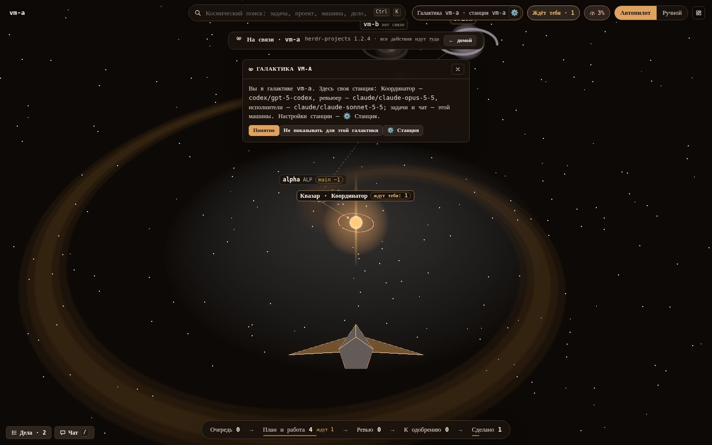
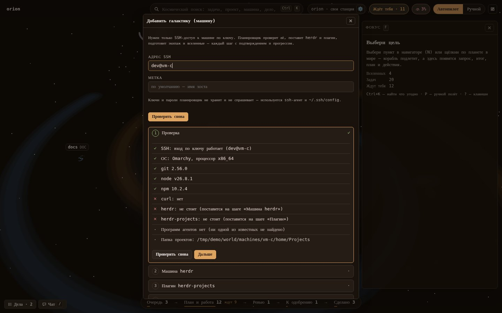

# Herdr Planner

**Your coding agents as a galaxy you fly through.** Herdr Planner is a local web dashboard for the
[herdr-projects](https://github.com/eliasstravik/herdr-projects) board (a plugin for the
[herdr](https://github.com/herdrdev/herdr) agent runtime). Your Coordinator is a quasar, projects are nebulae, tasks are
planets, sub-agents are their moons and other machines are distant galaxies. You pilot a ship between them (or
let the autopilot do it), see what is waiting for you, answer, approve and hand out work, without leaving the
view. One Rust binary, no cloud service of its own, no telemetry. Linux and macOS; install with one `curl … | sh`
line (see «Установка»). The interface is in Russian and English; the rest of this README is in Russian.


Herdr Planner — это **Галактика** вашей доски [herdr-projects](https://github.com/eliasstravik/herdr-projects):
трёхмерный мир, по которому летает корабль оператора. Он нужен тем, кто держит много агентов сразу
(Claude, Codex, omp, pi…) на нескольких проектах и машинах и хочет видеть всю картину разом: что идёт, что
застряло, что ждёт ответа человека. Всё, что можно сделать на доске, делается отсюда: одобрить, ответить, перенести дело,
завести задачу, добавить проект или целую машину.


## Образ

| На доске | В Галактике |
|---|---|
| Машина с доской | **Галактика** — диск со спиральными рукавами; ваша — в центре, другие — **далёкие галактики** за границей |
| Координатор | **Квазар** в центре: неоновый шар, джеты — его речь, кольца — лимиты подписок, шкала — память (контекст) |
| Проект (git-репозиторий) | **Туманность**; папка проектов — рукав спирали, тихие проекты — дальше и тусклее |
| Задача | **Планета**; цвет и значок — статус, кольцо-ангар — основной агент (форма метки — программа) |
| Субагент | **Спутник** планеты: живой, пока работает |
| Связь `after` («начнётся после») | Линия между планетами |
| Один репозиторий на двух машинах | **Мост** с подписью вроде «main −2» (клон отстал от главной ветки) |
| Вы | **Корабль**: виден сзади; в ручном полёте — его нос внизу кадра |

Цвет статуса дублируется значком и подписью, поэтому мир читается и без различения цветов.

## Установка

Одна строка, без root (системные пакеты — только недостающие и с вопросом):

```sh
curl -fsSL https://github.com/salehardec/herdr-planner/releases/latest/download/install.sh | sh
```

> [!NOTE]
> Архивы релизов собирает `.github/workflows/release.yml` по тегу `v*`. Пока в репозитории нет ни одного
> релиза, строка выше отвечает 404: ставьте из клона (`git clone https://github.com/salehardec/herdr-planner &&
> cd herdr-planner && scripts/install.sh --from-source`, нужны Node 22+ и Rust; страницу и бинарник скрипт соберёт сам).

**Что она ставит** (семь шагов, каждый печатает результат; повторный запуск безопасен):

| Шаг | Что делает |
|---|---|
| 1–2 | Определяет систему; доставляет недостающее из `git`, `curl`, `jq`, `ssh` (через `pacman`, `apt-get` или `brew`; `sudo` — только после вашего «да» или с `--yes`) |
| 3 | **herdr** 0.9.3 или новее — через [mise](https://mise.jdx.dev) (`github:herdrdev/herdr`); уже стоящий не через mise не трогает |
| 4 | Плагин **herdr-projects** (`herdr plugin install eliasstravik/herdr-projects`, при повторе — `update`) |
| 5 | Сам **планировщик**: готовый бинарник из релиза, контрольная сумма сверяется; `--from-source` — сборка из клона |
| 6 | **Службу** (`systemd --user`, на macOS — `launchd`), которая держит его запущенным. На Omarchy ещё: ярлык «отдельным окном», клавиша Hyprland и значок в панели |
| 7 | Вход и адрес: спрашивает, открывать ли доступ с других машин (по умолчанию нет) |

Куда что ложится: `~/.local/bin/herdr-planner` и `herdr-planner-open`, распакованный релиз — в
`~/.local/share/herdr-planner/release/<версия>/`, служба — `~/.config/systemd/user/herdr-planner.service`,
настройки — `~/.config/herdr-planner/config.toml`, данные — `~/.local/state/herdr-planner/`. Блок `PATH` для
login-shell дописывается в `~/.profile` (и `~/.zprofile`) между маркерами.

**Системы.** Linux x86_64 и aarch64 — Arch/Omarchy (`pacman`) и Debian/Ubuntu (`apt`); на другом дистрибутиве поставьте
`git curl jq ssh` сами, остальное сделает скрипт. macOS (Apple Silicon, Intel — экспериментально) собирается в CI, но
`launchd` и `brew` на настоящем Mac пока не проверялись. Windows не поддерживается.

**Команды** (после `| sh -s --` или `sh install.sh` в клоне):

```sh
curl -fsSL …/install.sh | sh -s -- --dry-run     # только показать шаги, ничего не менять
curl -fsSL …/install.sh | sh -s -- status         # что стоит, где, по какому адресу, отвечает ли служба
curl -fsSL …/install.sh | sh -s -- uninstall      # снять планировщик, службу, ярлык, значок
```

`uninstall` не трогает herdr и плагин, а также конфиг и данные (`~/.config/herdr-planner`,
`~/.local/state/herdr-planner`). Полезные флаги: `--yes`, `--version vX.Y.Z` (закрепить версию), `--no-herdr`, `--no-plugin`,
`--no-service`, `--user NAME --password-stdin --listen ADDR`, на Omarchy `--no-hypr`, `--no-shell`, `--key "SUPER + ALT + P"`.

**Обновление** — та же строка ещё раз: скрипт сравнит версии, обновит herdr, плагин и планировщик и перезапустит службу, если
что-то изменилось.

После установки откройте <http://127.0.0.1:7117> (на Omarchy — значок в панели или `herdr-planner-open`). На пустой доске
Галактика предложит добавить первые проекты из `~/Projects`.

## Что внутри кабины


- **Навигатор** (`N`): Галактика → туманность → задачи по датам создания → спутники. Без WebGL это главный вид.
- **Фокус** (`F`): запрос к человеку и ответы (разрешение, план, диалог на экране агента, ревью), итог агента
  (`closing.md`), описание, субагенты, связи. Текст не на языке интерфейса можно перевести кнопкой.
- **Ждёт тебя** (`B`): очередь запросов; ответили — запрос вычеркнут, курсор на следующем.
- **Чат с Координатором** (`/`): история, поиск по чату, вложения (текст, картинки, звук: скрепка, перетаскивание, `Ctrl/Cmd+V`), шкала памяти, многострочная строка ввода до 100 000 символов (`Enter` — отправить, `Shift+Enter` — новая строка), кнопки «Сжать» и «Новый»
  (в английском интерфейсе *Compact* и *New*). Кнопка **«Развернуть»** раскладывает окно колонками: навигатор | чат на всю
  высоту | «Фокус» (мир за ними приглушён); кнопка «Дела» в шапке развёрнутого чата открывает дела колонкой между навигатором
  и чатом (если места не хватает на колонку дел и чат от 30 rem, «Фокус» уходит в сторону, пока дела открыты); `Esc` — на шаг
  назад (дела → обычный чат → скрыть). Развёрнутость и дела запоминаются в браузере.
- **Дела** (`T`) — выпадающая панель **сверху** (quake): выезжает из-под строки поиска полосой по центру, `T` и `Esc`
  (на шаг назад) убирают её. Чат — внизу: оба открыты разом и не перекрывают друг друга, навигатор и «Фокус». Поле ввода
  дела — многострочное: текст переносится по ширине, поле растёт до нескольких строк и дальше прокручивается, `Enter`
  добавляет дело, `Shift+Enter` — новая строка (переносы сохраняются). Поле принимает до 100 000 символов; более длинный
  текст не обрезается, а отклоняется с сообщением. В списке длинное дело свёрнуто до трёх строк с кнопкой «ещё». К делу
  можно прикрепить файлы — текст, картинки, звук: «Обзор…», перетаскивание на панель, вставка скриншота (`Ctrl/Cmd+V`); до
  сохранения у каждого есть превью. Файлы лежат на сервере (за входом; картинка до 10 МБ, звук до 25 МБ, текст до 2 МБ; вид
  определяется по байтам, HTML и SVG — просто текст) и едут вместе с делом путями на машине с доской, когда оно становится
  сообщением или задачей. Карточку можно перетащить: **в чат** — черновик сообщения Координатору со вложениями (дело остаётся
  в списке с пометкой и уходит из него, когда сообщение отправлено); на
  **планету** — окно правки, затем `tell` её агенту; на **Квазар** — Координатору; на **туманность** — окно новой задачи
  (слова, файлы, проект, программа, модель; файлы идут в описание).
- **Канбан-строка** внизу: «Очередь · План и работа · Ревью · К одобрению · Сделано», счётчики и фильтр мира.
- **Поиск** (`Ctrl+K`, по центру сверху, ничем не перекрывается): задачи, проекты, машины, дела и сообщения чата; нечёткий — с опечатками, `е`/`ё` и не той раскладкой.
- **Лимиты подписок** (`Q`), **журнал** (`J`), **архив** (`R`).


### Далёкие галактики

Другие машины доски — SSH-хосты. Перелёт к ним — подключение; дальше чат, ответы, `tell`/`approve`, связи и новые
задачи идут туда. Ключи и пароли SSH планировщик не хранит и не спрашивает: только `ssh-agent` и ваш `~/.ssh/config`.



**Добавить галактику** (навигатор → «Добавить галактику…») можно по одному SSH-доступу: мастер из шести шагов проверяет
машину (SSH, ОС, git, node, curl, herdr, плагин, агенты), ставит herdr и плагин той же версии, готовит экипаж и
предлагает вселенные из её `~/Projects`. Каждый шаг идёт с подтверждением, прогрессом и кнопкой «Повторить».



### Станция и бортовой компьютер

У каждой галактики — своя **станция** (шестерёнка в верхней строке): какие программы агентов стоят на машине и вошли ли
они, какая программа и модель ведут каждую роль (Координатор, Планировщик, Ревьюер, исполнители) и все настройки доски со
значением и источником. Правка идёт через `herdr-projects set`/`unset`, сначала карточкой «было → стало» и списком задач,
которых это касается, потом подтверждением.


**Бортовой компьютер** (меню) — настройки самого планировщика, одинаковые для всех галактик: язык, мышь, упрощённый
режим, уведомления, папка для новых вселенных, логин и пароль, адрес прослушивания.

### Проекты

«Добавить вселенную»: папка с git или адрес репозитория (GitHub через `gh`, GitLab.com и свой GitLab через `glab`).
**Своё** — клон; **чужое, хочу менять** — форк (`origin` — ваш, `upstream` — оригинал, есть «подтянуть» и «PR/MR в оригинал»);
**чужое, изучать** — клон без записи. Одинаковые проекты на разных машинах связаны мостом; отставший клон помечен
«main −N», а «Предложить обновить» заводит задачу на доске той машины (в чужих чекаутах планировщик сам ничего не меняет).

## Управление

**Автопилот** (по умолчанию): выберите цель в навигаторе (`N`) или найдите поиском (`Ctrl+K`), и корабль сам прилетит
(разгон → варп → торможение). Мышь вращает обзор вокруг цели, колесо — ближе/дальше, клик по вещи — перелёт к ней.

**Ручной полёт** (`P`): как в игре. `W A S D` или стрелки — вперёд/назад/вбок, `Space` / `C` — вверх/вниз, `Shift` — форсаж,
колесо — круизная скорость, мышь — курс (клик по пустому месту захватывает мышь, `Esc` отпускает). Наведите прицел на
туманность, планету, спутник, Квазар или далёкую галактику и кликните (или удержите) — корабль нырнёт в неё. Границу
Галактики не пересечь: корабль мягко разворачивается. Клавиши читаются по физической клавише, раскладка не важна.


**`Esc` — ровно один шаг назад**, как «назад» в браузере: закрыть панель → выйти из «Фокуса» → из туманности. Действие
(одобрить, ответить, связать) оставляет вас на месте; а то, куда вы сами перелетели, кладётся в стек, и `Esc` вернёт обратно
с камерой, панелями и выделением.

| Клавиши | Что делают |
|---|---|
| `Ctrl+K` | космический поиск (по центру сверху) |
| `Ctrl+=` / `Ctrl+−` / `Ctrl+0` | масштаб интерфейса: крупнее / мельче / авто (масштаб страницы браузера не трогают) |
| `P` | автопилот ⇄ ручной полёт |
| `N` / `F` / `T` / `J` / `R` | навигатор / фокус / дела (панель сверху) / журнал / архив |
| `B` | «Ждёт тебя»: очередь запросов; `1–9` — N-й запрос |
| `/` | чат с Координатором |
| `H` | домой (своя Галактика) · `0` / `Home` — общий вид |
| `Enter` | подлететь к выбранному |
| `Tab` / `Shift+Tab` | следующая / предыдущая планета по срочности |
| `[` / `]` | предыдущая / следующая туманность |
| `L` или `Shift` + тяни | связь `after` между задачами |
| `Q` | лимиты подписок |
| `?` | подсказка · `Esc` — шаг назад |

**Упрощённый режим** включается сам при слабом железе, по `prefers-reduced-motion`, через `?calm` или в бортовом компьютере: без
bloom и движения частиц, перелёты мгновенные. Без WebGL остаются навигатор, поиск и все действия.

**Размер интерфейса.** Все размеры — в `rem`, корневой шрифт растёт с окном (16 px до 1600×1000, дальше пропорционально
экрану: 2K ≈ 23 px, 4K ≈ 35 px), подписи мира и HUD тоже. «Масштаб интерфейса» в бортовом компьютере (авто или 80–250 %)
и `Ctrl+=` / `Ctrl+−` / `Ctrl+0` заменяют авто на фиксированный процент от 16 px; выбор помнится в браузере.
Окна, при которых раскладка меняется (до 1100, 1000, 900 px…), считаются в тех же единицах: чем крупнее интерфейс, тем «уже» для него окно,
и на 150 % окно 1366 px получает ту же раскладку, что окно 911 px при авто.

## Вход и удалённый доступ

По умолчанию служба слушает только `127.0.0.1:7117`, вход не нужен. Адрес, не являющийся loopback, без пароля планировщик
не запустит. Открыть доступ можно тремя способами.

**Логин и пароль** (чтобы слушать другие адреса). Установщик спросит их сам или:

```sh
curl -fsSL …/install.sh | sh -s -- password --user me --listen 0.0.0.0    # пароль — вопросом в терминале
printf '%s' "$PW" | sh install.sh password --user me --password-stdin       # из клона, без вопроса
```

Пароль хранится как хеш Argon2id в `config.toml` (права `600`), сессия — cookie `HttpOnly; Secure; SameSite=Strict`, после
5 неудачных попыток за 5 минут адрес блокируется, а весь API и поток событий закрыты входом. Логин и пароль можно сменить
и в бортовом компьютере, но только с самой машины планировщика.


**HTTPS.** Cookie сессии `Secure`, поэтому по обычному `http://` с другой машины браузер её не сохранит. Свой сертификат:
`sh install.sh tls --cert fullchain.pem --key privkey.pem` (пишет `tls_cert`/`tls_key` в конфиг и перезапускает службу).

**SSH-туннель** — проще всего и без паролей и сертификатов: на своём компьютере

```sh
ssh -N -L 7117:127.0.0.1:7117 user@хост    # затем http://localhost:7117
```

Для браузера `localhost` — защищённый контекст, так что `Secure`-cookie работает и без TLS. Службе достаточно слушать `127.0.0.1`.

**Tailscale.** Оставьте службу на `127.0.0.1`, задайте пароль и опубликуйте её в вашей сети:

```sh
tailscale serve --bg 7117      # HTTPS-адрес вида https://<машина>.<tailnet>.ts.net
```

Прокси на той же машине передаёт `X-Forwarded-For`, и планировщик берёт из него адрес клиента (только когда соединение пришло с loopback,
поэтому подделать заголовок снаружи нельзя). Без пароля доступ получит каждый в вашей tailnet, так что пароль обязателен.

## Как устроено

```
 браузер ──HTTP/SSE──▶ herdr-planner (Rust) ──CLI──▶ herdr-projects ──▶ herdr ──▶ агенты
   (three.js)              │  └─ следит за файлами доски (notify)          (плагин)  (Claude, Codex, omp, pi…)
                           └─ SSH ──▶ далёкие машины (их herdr-projects)
```

Планировщик ничего не пишет в файлы доски: читает их, а все действия (ответить, одобрить, завести задачу, сменить
настройку) делает командами `herdr-projects`, как человек в терминале. Поэтому доска остаётся единственным источником правды, а
herdr и [herdr-projects](https://github.com/eliasstravik/herdr-projects) работают и без планировщика. Сам [herdr](https://github.com/herdrdev/herdr) нужен
только как среда плагина: открытый интерфейс herdr для работы не требуется.

- **Сервер:** Rust, axum, tokio; один бинарник со страницей внутри (`rust-embed`). **SQLite** (`rusqlite`, WAL): дела,
  журнал, история статусов, индекс чата и поиск FTS5. Живые обновления по SSE (`GET /api/events`), доска сторожится через `notify`,
  страховочный опрос раз в минуту. Без Postgres, Redis, Docker и Electron.
- **Страница:** TypeScript, Vite, three.js и `postprocessing` (неон), туманности — частицы на шейдерах, планеты —
  `InstancedMesh`, Preact, GSAP, uFuzzy. Подробнее: [`design/world.md`](design/world.md).
- **Окно:** на Omarchy значок и клавиша открывают отдельное окно Chromium (app window) в своём профиле; на других системах
  откройте адрес в браузере.

**Где данные:**

| Что | Где |
|---|---|
| Доска (задачи, итоги, Координатор) | `~/.herdr-projects/data`, принадлежит herdr-projects; планировщик читает |
| Настройки планировщика | `~/.config/herdr-planner/config.toml` (`600`) |
| Дела, журнал, история статусов, индекс чата и поиска, кэши | `~/.local/state/herdr-planner/` (SQLite, `600`) |
| Картинки из чата | `~/.local/state/herdr-planner/attachments/` |
| Бинарник и распакованные релизы | `~/.local/bin/`, `~/.local/share/herdr-planner/release/` |

Настройки `config.toml` (все ключи необязательны): `listen`, `port` (7117), `data`, `user`, `password_hash`, `tls_cert`, `tls_key`,
`translator` (`claude/<модель>` или `omp/<модель>`), `projects_dir` (`~/Projects`), `ssh_bin`. Приоритет: аргументы
`--listen/--port/--data`, затем `HERDR_PLANNER_LISTEN`, `HERDR_PLANNER_PORT`, `HERDR_PROJECTS_DATA_DIR`, затем конфиг. Переменные
`HERDR_PROJECTS_BIN`, `HERDR_BIN`, `HERDR_PLANNER_SSH`, `HERDR_PLANNER_CLAUDE`, `HERDR_PLANNER_GH`, `HERDR_PLANNER_GLAB` подменяют программы (так
работают проверки).

## Разработка

```sh
scripts/web-build.sh          # страница → ~/.cache/herdr-planner/web/dist
scripts/web-build.sh --test   # vitest
cargo build --release         # бинарник со страницей внутри
scripts/run-checks.sh         # всё сразу (см. ниже)
```

**Сборка и NTFS.** На NTFS (и вообще на разделах, откуда нельзя запускать исполняемые файлы) нативные esbuild и rollup не
стартуют, поэтому `scripts/web-build.sh` собирает страницу в копии `~/.cache/herdr-planner/web/src-copy`, вне репозитория. Рядом
стоит держать и каталог сборки Rust: `CARGO_TARGET_DIR=~/.cache/herdr-planner/target` (его же берут `run-checks.sh` и
`install.sh --from-source`). `build.rs` ищет страницу в `$HERDR_PLANNER_DIST`, затем в кэше, затем в `web/dist`.

**Проверки.** `scripts/run-checks.sh [каталог-для-снимков]` прогоняет всё, что можно проверить офлайн: `vitest` (раскладка на
50 проектов и 500 задач, полёт и граница, навигатор, поиск, i18n — в том числе проверка, что в исходниках нет слов вне словаря, а русский словарь русский), `cargo test`, установщик во временном `HOME`
(`scripts/check-install.sh`, с `shellcheck`), запуск окна (`scripts/check-open.sh`), затем страницу в headless Chromium на
**фикстуре** и вход по паролю. Фикстура (`scripts/fixture.mjs`, описание — `scripts/fixture-notes.md`) — это целый поддельный мир:
доска, машины `vm-a`/`vm-b`, подставные `herdr-projects`, `herdr`, `ssh`, `claude`, `gh`, `glab`, git-репозитории с отставанием;
ничего настоящего она не трогает. С `--scale 50x500` она проверяет плавность большого мира. Нужны Node 22+, Rust и Chromium
(`CHROMIUM=/путь`, если он не `chromium`). Те же проверки гоняет CI (`.github/workflows/ci.yml`): параллельные задания (`web` — vitest и tsc, `bin` — страница и отладочный
бинарник один раз, `rust` — `cargo test`, `scripts` — установщик и запуск окна, `pages` — страница в Chromium, по раннеру на каждую из
семи частей `ui1…ui5`, `big`, `auth`) и одна итоговая обязательная проверка `checks`, которая ждёт все остальные. Кеши: npm,
cargo (реестр, git, `target` — пишет только `main`). На PR прогон идёт один раз и новый push заменяет предыдущий; на push в `main`
после слияния идут только быстрые части (тот же код уже прошёл на PR). Целиком на любой ветке — вручную (`workflow_dispatch`).
`SHARDS="ui2 big" PAGE_ONLY=1 scripts/run-checks.sh` запускает те же части локально по отдельности.

**Устойчивость проверок страницы.** Они идут на общих, загруженных машинах (раннеры GitHub Actions, соседние прогоны), поэтому
проверка ждёт *состояния* (`world.debug()`, DOM, конец полёта, ответ сервера) с запасом по времени, а не пауз и порогов скорости:
зажатая клавиша держится, пока корабль не сдвинется, двойное нажатие делается за один тик страницы, «нельзя» проверяется после
барьера «страница обработала всё, что было в очереди». У каждого прогона свой каталог фикстуры, своя копия браузера и свой порт
(сервер проверяется, что он наш). Секция, которая всё же упала, если она безопасна для повтора, запускается ещё раз с чистой
страницы — и это видно: строка `RETRY …` в выводе, `RETRIED …` и предупреждение в итоге. `NO_RETRY=1` выключает повтор.
`scripts/stress-checks.sh [прогонов] [нагрузчиков]` гоняет проверки страницы подряд рядом с занятыми ядрами и без повторов;
в CI то же — ручной запуск workflow «CI» (`workflow_dispatch`, поле `repeat`). `PAGE_ONLY=1 scripts/run-checks.sh` пропускает сборку и
прочие проверки, когда бинарник и страница уже собраны.

**Снимки для README** — `node scripts/readme-shots.mjs` (собирает фикстуру во временной папке, запускает планировщик и
Chromium и пишет `docs/img/`). Снимки берутся только с фикстуры: ни настоящих имён репозиториев, ни путей, ни адресов.

**Релизы.** Поднимите `version` в `Cargo.toml`, закоммитьте, поставьте тег `vX.Y.Z` и отправьте его: `release.yml` проверит, что тег равен
версии, соберёт архивы `herdr-planner-<linux|macos>-<x86_64|aarch64>.tar.gz` с `.sha256`, приложит `install.sh` и `SHA256SUMS` и
опубликует релиз. Именно оттуда берёт файлы одна строка установки.

```
src/main.rs                        запуск, CLI (hash-password, set-auth, set-tls)
src/server.rs, api.rs              маршруты, действия, чат
src/board.rs, taskmeta.rs          доска → задачи, ссылки, статусы
src/machines.rs, gitlag.rs         далёкие галактики по SSH, отставание клонов
src/station.rs, ship.rs, galaxy_setup.rs   станция, бортовой компьютер, мастер галактики
src/universe.rs                    добавить проект: папка / клон / форк / изучение
src/db.rs                          SQLite, FTS5
web/src/world/                     сцена: Квазар, туманности, тела, связи, корабль
web/src/ui/                        панели Preact
packaging/                         systemd, launchd, .desktop, значок, виджет панели Omarchy
```

## Безопасность и приватность

- **Что хранится.** Только локально, у вас на машине: настройки, хеш пароля (Argon2id), дела, журнал, индекс чата, вложения чата и
  дел (таблица выше). Файлы конфига и базы — с правами `600`. Пароль и ключи SSH не хранятся и в журнал не пишутся.
- **Что уходит наружу.** Ничего, кроме действий, которые вы запустили сами. Нет телеметрии, аналитики, внешних шрифтов, CDN и
  скриптов: страница не обращается ни к каким чужим адресам, а `Referrer-Policy` — `no-referrer`. Сеть задействована только так:
  вызовы `herdr-projects` (он и агенты ходят в свои сервисы), SSH к добавленным вами машинам, `gh` / `glab` при добавлении
  проекта, и «Перевести» — текст передаётся вашей же программе `claude` или `omp` (на сервере, без инструментов и сессии), а
  дальше действуют условия её провайдера. Установщик скачивает архив релиза с GitHub, mise и плагин.
- **SSH.** `BatchMode=yes` (никаких вопросов и паролей), `StrictHostKeyChecking=accept-new`: неизвестный хост запоминается при первом
  подключении, смена ключа известного хоста — отказ.
- **Доступ.** Без пароля — только loopback. JSON-запросы проверяют `Origin`, а cookie — `SameSite=Strict`; открыть терминал, файлы или сменить
  логин и адрес может только тот, кто сидит за самой машиной (при прокси — по `X-Forwarded-For`).
- **Фикстуры и снимки** не содержат личных данных: имена `alpha`, `vm-a`, `orion`, `acme/…` выдуманы.

Нашли уязвимость — напишите владельцу репозитория приватно (GitHub → Security → *Report a vulnerability*), а не в открытый issue.

## Лицензия

[MIT](LICENSE) © 2026 Aleksey Abaydulin.
